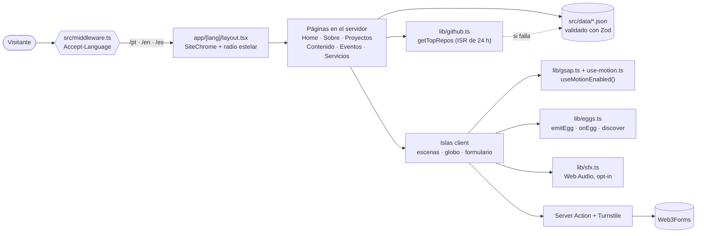

<div align="center">

[English](README.md) · [Português](README.pt-BR.md) · **Español**

<br />

# glaucialemos.dev

### *Ingeniería, IA y curiosidad en una expedición por un universo original en pixel art.*

[](https://github.com/glaucia86/glaucialemos.dev/actions/workflows/ci.yml)


[](https://github.com/glaucia86/glaucialemos.dev/stargazers)


<br />


<sub>Observatório das Primeiras Luzes — fondo aprobado de la Home. Glaucia, Prince y los objetos interactivos se renderizan en capas separadas.</sub>

</div>

---

> **Una expedición por la ingeniería, el conocimiento y la imaginación.**
>
> **Galáxia Encantada** es la nueva identidad creativa del portafolio de Glaucia Lemos:
> un universo espacial original en pixel art, con Glaucia y su perro, Prince, como
> exploradores. Cada destino conecta el trabajo real en **ingeniería, liderazgo e IA**
> con un mundo por descubrir, manteniendo accesible el contenido profesional.

> [!IMPORTANT]
> **Migración en curso:** la Home ya se ha migrado y aprobado. Sobre, Proyectos, Contenido,
> Eventos, Servicios y la página 404 todavía conservan la identidad anterior y se migrarán
> a continuación. Los destinos de abajo representan el plan de migración, no un rediseño
> terminado de todas las rutas. El modo historia opcional también está planificado.

---

## Índice

- [Sobre el proyecto](#sobre-el-proyecto)
- [Destacados](#destacados)
- [Pipeline de arte](#pipeline-de-arte)
- [Stack](#stack)
- [Arquitectura](#arquitectura)
- [Cómo ejecutar](#cómo-ejecutar)
  - [Requisitos previos](#requisitos-previos)
  - [Windows](#windows)
  - [macOS](#macos)
  - [Linux](#linux)
  - [Variables de entorno](#variables-de-entorno)
- [Scripts disponibles](#scripts-disponibles)
- [Pruebas](#pruebas)
- [Estructura del proyecto](#estructura-del-proyecto)
- [Caza de easter eggs](#caza-de-easter-eggs)
- [Para saber más](#para-saber-más)
- [Créditos y dirección creativa](#créditos-y-dirección-creativa)
- [Sobre mí](#sobre-mí)

---

## Sobre el proyecto

**glaucialemos.dev** es el sitio personal y portafolio de **Glaucia Lemos**, Principal
Software Engineer y AI Transformation Lead. **Galáxia Encantada** transforma el portafolio
en una expedición por observatorios, mundos imaginarios y estaciones orbitales.
La migración conserva las rutas existentes, los datos profesionales y los tres idiomas.

| Ruta | Destino de Galáxia Encantada | Contenido | Estado de la migración |
| --- | --- | --- | --- |
| `/` | Entrada por idioma | Elige `/pt`, `/en` o `/es` según `Accept-Language` | Conservada |
| `/[lang]` | Observatório das Primeiras Luzes (Tierra) | Presentación, telescopio de carrera, proyectos y contacto | Migrada y aprobada |
| `/[lang]/sobre` | Nivéora, o Mundo Nevado das Auroras | Trayectoria profesional e hitos de carrera | Próxima |
| `/[lang]/projetos` | Marte, Vale das Invenções | Datos de GitHub en vivo, repositorios y contribuciones | Planificada |
| `/[lang]/conteudo` | Lúmina, a Biblioteca Viva | Artículos y recursos de aprendizaje | Planificada |
| `/[lang]/eventos` | Atlas das Conexões (órbita de la Tierra) | Globo interactivo e historial de charlas | Planificada |
| `/[lang]/servicos` | Aurélia, os Jardins Suspensos | Talleres, mentorías, charlas y contacto | Planificada |
| `404` | Maré Rubra, Coordenadas Perdidas | Una ruta perdida y un camino de regreso | Planificada |

La implementación sigue el [plan de migración](docs/galaxia-encantada/PLANO-MIGRACAO.md)
página por página, con aprobación visual antes de continuar.

## Destacados

- **Cinematográfico, sin estorbar.** Timelines de GSAP (ScrollTrigger, SplitText, ScrambleText)
  y el desplazamiento suave de Lenis mueven las escenas. La navegación nunca espera una animación.
- **El movimiento te respeta.** `prefers-reduced-motion` *o* un botón manual dejan todas las
  escenas estáticas, y la elección se mantiene en todas las pestañas. Sin JavaScript, el sitio
  sigue siendo legible.
- **Sonido solo con opt-in.** Los efectos se sintetizan en vivo con la Web Audio API. No hay
  archivos de audio, y todo queda en silencio hasta que lo actives.
- **Tres idiomas, un solo esquema de URL.** Cambiar de idioma reemplaza solo el primer segmento
  de la URL, así que sigues en la misma página.
- **Datos validados.** Cada JSON (eventos, proyectos, carrera, servicios) pasa por Zod al cargar.
  Un registro inválido rompe el build en lugar de llegar a producción.
- **GitHub en vivo.** `getTopRepos` ordena los repositorios por estrellas y revalida cada
  24 horas. Si la API falla o tarda, se usa la copia local.
- **Pixel art en capas.** Scripts de Node procesan fondos, poses y objetos aprobados.
  Glaucia permanece anclada en la escena, parpadea y cambia de pose durante las interacciones.
- **Un cielo por explorar.** La nueva Home tiene auroras, estrellas fugaces que se pueden
  atrapar, faroles, un telescopio de carrera y el despegue de una nave, con Prince en los descubrimientos.
- **Secretos accesibles.** Un registro único de easter eggs permite interactuar mediante
  teclado, tacto y radio estelar. Los secretos se sustituyen a medida que se migra cada mundo.

## Pipeline de arte

Las imágenes fuente aprobadas están en [`docs/art/galaxia-encantada/approved-source`](docs/art/galaxia-encantada/approved-source).
Cada escena separa el fondo, las poses de Glaucia y Prince y los objetos interactivos.
El script recorta las poses, extrae la capa de parpadeo, registra los anclajes y exporta los
assets en WebP junto con los metadatos de la escena.

```bash
node scripts/build-galaxia-assets.mjs earth-observatory --debug
node scripts/build-galaxia-assets.mjs --manifest
```

Los archivos generados están en `public/galaxia/` y `src/data/galaxia/`. El manifiesto registra
los hashes de las fuentes y las aprobaciones. La composición y los hotspots se definen en
`src/lib/scenes.ts` y `src/components/home/ObservatoryScene.tsx`.

## Stack

| Capa | Elección | Por qué |
| --- | --- | --- |
| Framework | [Next.js 15](https://nextjs.org/) (App Router) | Páginas server-first, rutas por idioma, ISR para los datos de GitHub |
| UI | [React 19](https://react.dev/) | Client Components solo donde hay interacción |
| Lenguaje | [TypeScript](https://www.typescriptlang.org/) (strict) | Datos, diccionarios e ids de easter eggs tipados |
| Estilos | [Tailwind CSS 4](https://tailwindcss.com/) + tokens semánticos | Tokens de marca compartidos y paletas propias para cada mundo |
| Movimiento | [GSAP 3](https://gsap.com/) + [Lenis](https://lenis.darkroom.engineering/) | Scroll fijado, scrub y efectos de texto que funcionan en todos los navegadores |
| Globo | [cobe](https://github.com/shuding/cobe) | Globo WebGL ligero para la página de Eventos |
| Validación | [Zod 4](https://zod.dev/) | Schemas para todos los datos |
| Pruebas | [Vitest](https://vitest.dev/) + [Playwright](https://playwright.dev/) | Pruebas unitarias y suites en navegador real |
| Fuentes | Geist, Geist Mono, Departure Mono | Alojadas localmente con `next/font/local` |
| Formularios | [Web3Forms](https://web3forms.com/) + [Turnstile](https://developers.cloudflare.com/turnstile/) | Ningún e-mail personal en el código |

## Arquitectura



## Cómo ejecutar

### Requisitos previos

| Herramienta | Versión | Cómo comprobar |
| --- | --- | --- |
| [Node.js](https://nodejs.org/) | **22 o más reciente** (el CI usa 22) | `node -v` |
| npm | viene con Node | `npm -v` |
| [Git](https://git-scm.com/) | cualquier versión reciente | `git --version` |

> [!TIP]
> Un gestor de versiones ([nvm](https://github.com/nvm-sh/nvm), [nvm-windows](https://github.com/coreybutler/nvm-windows),
> [fnm](https://github.com/Schniz/fnm) o [Volta](https://volta.sh/)) cambia a Node 22 con un solo comando.

### Windows

**1. Instala Node.js LTS y Git** (PowerShell, con [winget](https://learn.microsoft.com/windows/package-manager/winget/)):

```powershell
winget install OpenJS.NodeJS.LTS
winget install Git.Git
```

Vuelve a abrir la terminal para que `node` y `git` estén en el `PATH`.

**2. Clona e instala:**

```powershell
git clone https://github.com/glaucia86/glaucialemos.dev.git
cd glaucialemos.dev
npm ci
Copy-Item .env.example .env.local
```

**3. Arranca el servidor de desarrollo:**

```powershell
npm run dev
```

Abre <http://localhost:3000>. Se te redirigirá a `/pt`, `/en` o `/es`.

> [!NOTE]
> En Windows, detener `npm run start` puede dejar el proceso `node` de Next escuchando en el puerto.
> Si ves `EADDRINUSE`, búscalo y deténlo:
>
> ```powershell
> netstat -ano | findstr :3000
> taskkill /PID <pid> /F
> ```

### macOS

**1. Instala Node.js 22 y Git** (con [Homebrew](https://brew.sh/)):

```bash
brew install node@22 git
echo 'export PATH="$(brew --prefix node@22)/bin:$PATH"' >> ~/.zshrc
source ~/.zshrc
```

**2. Clona e instala:**

```bash
git clone https://github.com/glaucia86/glaucialemos.dev.git
cd glaucialemos.dev
npm ci
cp .env.example .env.local
```

**3. Arranca el servidor de desarrollo:**

```bash
npm run dev
```

Abre <http://localhost:3000>.

### Linux

**1. Instala Node.js 22 con [nvm](https://github.com/nvm-sh/nvm)** (funciona en cualquier distro):

```bash
curl -o- https://raw.githubusercontent.com/nvm-sh/nvm/v0.40.3/install.sh | bash
source ~/.bashrc
nvm install 22
```

Git: `sudo apt install git` (Debian/Ubuntu), `sudo dnf install git` (Fedora) o `sudo pacman -S git` (Arch).

**2. Clona e instala:**

```bash
git clone https://github.com/glaucia86/glaucialemos.dev.git
cd glaucialemos.dev
npm ci
cp .env.example .env.local
```

**3. Arranca el servidor de desarrollo:**

```bash
npm run dev
```

Abre <http://localhost:3000>.

#### Build de producción (todos los sistemas)

```bash
npm run build
npm run start -- --hostname 127.0.0.1 --port 3100
```

### Variables de entorno

Todas son **opcionales**. El sitio funciona sin ninguna.

| Variable | Dónde | Qué hace |
| --- | --- | --- |
| `WEB3FORMS_ACCESS_KEY` | solo servidor | Clave de Web3Forms usada por la Server Action de contacto. Nunca se envía al navegador. |
| `NEXT_PUBLIC_TURNSTILE_SITE_KEY` | navegador (build) | Clave pública del widget Turnstile. El script oficial solo carga cuando el formulario entra en pantalla. |
| `TURNSTILE_SECRET_KEY` | solo servidor | Secreto para validar el token mediante Siteverify de Cloudflare antes del envío. |
| `GITHUB_TOKEN` | solo servidor | Aumenta el límite de la API de GitHub usada para ordenar los repositorios por estrellas. Sin ella, se usa el límite público, con `src/data/projetos.json` como respaldo. |

El formulario requiere las tres variables de contacto; si falta cualquiera, los campos y el envío se deshabilitan y el botón de LinkedIn sigue disponible. Copia `.env.example` a `.env.local`, configura las claves y vuelve a compilar si cambias la clave pública o la configuración del formulario. No uses variables `NEXT_PUBLIC_*` para las dos claves del servidor. Configura el destinatario en Web3Forms sin incluir un correo personal en el repositorio.

La Server Action valida el schema Zod compartido, descarta el honeypot, verifica Turnstile y envía a Web3Forms. [El uso de Web3Forms desde el servidor requiere un plan de pago y autorización de la IP del servidor](https://docs.web3forms.com/getting-started/api-reference). Autoriza el hostname del sitio en Turnstile. Sin JavaScript, el formulario conserva la Server Action, pero la verificación no puede ejecutarse; el enlace visible de LinkedIn es la alternativa. Los datos no se añaden a listas de correo.

Ejecuta `node tests/aurelia.browser.mjs` contra el servidor elegido. `CONTACT_EXPECT=disabled` exige configuración ausente; `CONTACT_EXPECT=enabled` exige configuración completa (usa builds separados para comprobar ambos). El script simula ambos proveedores y el propio POST de la action, impidiendo envíos reales. Vitest simula fetch en el servidor para comprobar cada variable ausente, la validación y las respuestas de los proveedores.

## Scripts disponibles

| Comando | Qué hace |
| --- | --- |
| `npm run dev` | Servidor de desarrollo con hot reload |
| `npm run build` | Build de producción (comprueba que aparezca `ƒ Middleware`) |
| `npm run start` | Sirve el build de producción |
| `npm run lint` | ESLint (`eslint-config-next`) |
| `npm run typecheck` | `tsc --noEmit` |
| `npm test` | Pruebas unitarias con Vitest |
| `npm run test:browser` | Suites de Playwright contra un servidor de producción |

## Pruebas

Las mismas comprobaciones se ejecutan en [GitHub Actions](.github/workflows/ci.yml) en cada push y pull request:

```bash
npm run lint && npm run typecheck && npm test && npm run build
```

Las suites de navegador cubren los CTAs del hero, las escenas, el ciclo de vida, los eventos
y las interacciones de las páginas. Algunas suites todavía describen páginas pendientes de migración.

```bash
npx playwright install chromium   # solo la primera vez
npm run build
npm run test:browser              # arranca un servidor en el puerto 3100 por ti
```

Para reutilizar un servidor que ya está en marcha, apunta las suites hacia él:

```bash
# macOS / Linux
BASE_URL=http://127.0.0.1:3100 npm run test:browser
```

```powershell
# Windows (PowerShell)
$env:BASE_URL = "http://127.0.0.1:3100"
npm run test:browser
```

## Estructura del proyecto

```text
glaucialemos.dev/
├── .github/workflows/ci.yml   # lint · typecheck · pruebas · build
├── docs/                      # notas de diseño, briefings de arte, capturas
│   └── galaxia-encantada/      # plan de migración y handoff
├── public/galaxia/            # fondos, personajes y objetos generados
├── public/pixel/              # assets antiguos, sustituidos página por página
├── scripts/                   # build-galaxia-assets y herramientas de arte
├── src/
│   ├── app/
│   │   ├── [lang]/            # home, sobre, projetos, conteudo, eventos, servicos
│   │   └── *.css              # tokens, UI pixel, estilos y efectos de las escenas
│   ├── components/
│   │   ├── home/              # Observatorio, cielo, telescopio de carrera, hiperespacio
│   │   ├── about/             # componentes de carrera; próximo mundo por migrar
│   │   ├── projects/          # archivo de repositorios y telemetría de GitHub
│   │   └── motion/            # FxLayer, SmoothScroll
│   ├── data/                  # eventos, proyectos, carrera, servicios (JSON + Zod)
│   │   └── galaxia/           # metadatos generados de las escenas
│   ├── i18n/                  # diccionarios pt · en · es
│   ├── lib/                   # github, career, eggs, sfx, gsap, use-motion
│   └── middleware.ts          # detección de idioma
└── tests/                     # *.test.ts (Vitest) · *.browser.mjs (Playwright)
```

## Caza de easter eggs

Abre la **radio estelar** en la cabecera para descubrir pistas, repetir los secretos y seguir
tu progreso. También puedes escribir una palabra clave directamente en la página. La nueva
Home tiene seis secretos locales y el mapa estelar global; las demás páginas conservan sus
secretos actuales hasta que se migren.

<details>
<summary><b>Spoilers: algunas pistas para el Observatorio</b></summary>

<br />

| Dónde | Pista |
| --- | --- |
| Cualquier página | Un código clásico de la era de 8 bits, escrito o con gestos: ↑ ↑ ↓ ↓ ← → ← → B A |
| Home | Glaucia tiene un telescopio con hitos reales de su carrera por explorar |
| Home | Sigue el olfato de Prince para encontrar una señal |
| Home | El hangar de la montaña y su consola están conectados |
| Home | Mantén pulsado el cielo durante la cuenta regresiva para que despegue la nave |
| Home | Apaga los cuatro faroles y mira hacia arriba |
| Home | Atrapa tres estrellas fugaces y pide un deseo |

</details>

<sub>En el móvil, cada secreto tiene un gesto táctil equivalente. "Borrar memoria" en la radio estelar reinicia el progreso.</sub>

## Para saber más

| Documento | Tema |
| --- | --- |
| [`PLANO-MIGRACAO.md`](docs/galaxia-encantada/PLANO-MIGRACAO.md) | Dirección creativa, mundos y plan de migración de Galáxia Encantada (en portugués) |
| [`HANDOFF.md`](docs/galaxia-encantada/HANDOFF.md) | Guía de implementación, preferencias y traspaso de contexto (en portugués) |
| [`AGENTS.md`](AGENTS.md) | Convenciones de ingeniería y comandos de verificación actuales |
| [`DESIGN-SYSTEM.md`](DESIGN-SYSTEM.md) | Paleta, tipografía, componentes, escenas (en portugués) |
| [`DECISOES.md`](DECISOES.md) | Registro de decisiones de arquitectura y sus motivos (en portugués) |

Los documentos antiguos de diseño todavía pueden describir la identidad anterior; el plan
de migración y el código actual definen la nueva dirección.

## Créditos y dirección creativa

**Galáxia Encantada** es la dirección creativa original del portafolio, definida y aprobada
por Glaucia Lemos. Los nuevos mundos cuentan con Glaucia, Prince y una nave concebida para
este universo. Las imágenes fuente se producen con ayuda de IA en Grok Image y se revisan
antes de integrarlas; su procedencia y las aprobaciones se registran en el manifiesto de assets.

La migración incorpora la nueva identidad página por página. Los assets y las referencias
restantes de la versión anterior se eliminarán conforme se migre y revise cada página.
Pide autorización antes de reutilizar las imágenes o los textos del proyecto.

---

## Sobre mí

<table>
  <tr>
    <td align="center" width="200">
      
      <br />
      <sub>Ingeniera, educadora y exploradora de Galáxia Encantada</sub>
    </td>
    <td>
      <h3>Glaucia Lemos</h3>
      <p><b>Principal Software Engineer · AI Transformation Lead @ Itaú Unibanco</b></p>
      <p>
        Lidero la adopción de IA generativa y agéntica en squads de ingeniería: SDLC con IA, RAG,
        context engineering y Spec-Driven Development.
      </p>
      <p>
        Microsoft MVP, OpenAI Codex Ambassador, Devin Ambassador y coautora en Packt. Pasé más de
        seis años como Developer Advocate en Microsoft y llegué a más de 100.000 desarrolladores con
        charlas, talleres y proyectos open source de JavaScript, TypeScript e IA.
      </p>
      <p>
        <a href="https://www.youtube.com/@GlauciaLemos"></a>
        <a href="https://www.linkedin.com/in/glaucialemos"></a>
        <a href="https://x.com/glaucia_lemos86"></a>
        <a href="https://www.instagram.com/glaucia.lemos.dev"></a>
        <a href="https://github.com/glaucia86"></a>
      </p>
    </td>
  </tr>
</table>

<div align="center">

<br />

**Si esta expedición te inspiró, [deja una estrella](https://github.com/glaucia86/glaucialemos.dev/stargazers).**

<sub>Galáxia Encantada · Sigue explorando.</sub>

</div>
