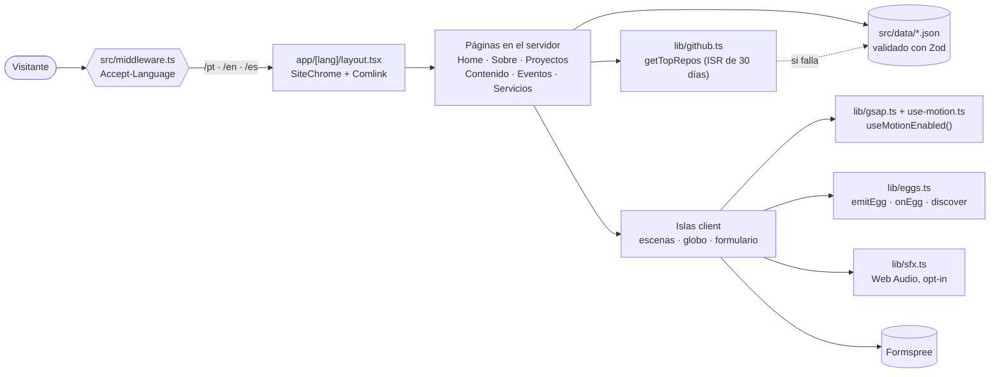

<div align="center">

[English](README.md) · [Português](README.pt-BR.md) · **Español**

<br />

<pre>
   ██████╗ ██╗         ·  HOLONET v4.2 // estableciendo conexión segura
  ██╔════╝ ██║         ·  cargando perfil: GLAUCIA_LEMOS
  ██║  ███╗██║         ·  clase: principal software engineer
  ██║   ██║██║         ·         ai transformation lead · microsoft mvp
  ╚██████╔╝███████╗    ·  ACCESO CONCEDIDO
   ╚═════╝ ╚══════╝
</pre>

# glaucialemos.dev

### *Un sitio personal contado como una transmisión de la HoloNet, en pixel art, desde una galaxia muy, muy lejana.*

[](https://github.com/glaucia86/glaucialemos.dev/actions/workflows/ci.yml)


[](https://github.com/glaucia86/glaucialemos.dev/stargazers)


<br />


<sub>Episodio I — El Origen. Haz clic para empujar las rocas, mantén pulsado para usar la Fuerza.</sub>

</div>

---

> **Hace mucho tiempo, en un repositorio muy, muy lejano...**
>
> Una desarrolladora convertida en educadora global necesitaba un hogar en la HoloNet. Nada
> de plantillas ni currículums encorsetados: quería un lugar donde **ingeniería, liderazgo
> e IA** se contaran como una historia. Armada con Next.js, una paleta pixelada y un amor
> terco por la accesibilidad, se propuso construir un sitio que se viera como una película
> y se leyera como documentación bien escrita...

---

## Índice

- [Sobre el proyecto](#sobre-el-proyecto)
- [Destacados](#destacados)
- [Galería](#galería)
- [Stack](#stack)
- [Arquitectura](#arquitectura)
- [Cómo ejecutar](#cómo-ejecutar)
  - [Requisitos previos](#requisitos-previos)
  - [Windows](#windows)
  - [macOS](#macos)
  - [Linux](#linux)
  - [Variables de entorno](#variables-de-entorno)
- [Scripts disponibles](#scripts-disponibles)
- [Pruebas](#pruebas)
- [Estructura del proyecto](#estructura-del-proyecto)
- [Caza de easter eggs](#caza-de-easter-eggs)
- [Para saber más](#para-saber-más)
- [Créditos y aviso legal](#créditos-y-aviso-legal)
- [Sobre mí](#sobre-mí)

---

## Sobre el proyecto

**glaucialemos.dev** es el sitio personal y portafolio de **Glaucia Lemos**, Principal
Software Engineer y AI Transformation Lead. Cada página es una escena en un planeta distinto,
y la Home se narra como una **transmisión de la HoloNet** en cinco episodios:

| Ruta | Escena | Qué vas a encontrar |
| --- | --- | --- |
| `/` | — | Elige `/pt`, `/en` o `/es` según la cabecera `Accept-Language` |
| `/[lang]` | Dagobah, con Yoda | La historia de la HoloNet en cinco episodios, cifras, proyectos y contacto |
| `/[lang]/sobre` | Base Eco, en Hoth | Trayectoria con carriles paralelos, Leia y C-3PO |
| `/[lang]/projetos` | R2-D2 | Repositorios de GitHub ordenados por estrellas |
| `/[lang]/conteudo` | Chewbacca | Artículos y contenidos con filtros |
| `/[lang]/eventos` | Grogu | Un globo arrastrable y el historial buscable de más de 130 charlas |
| `/[lang]/servicos` | Darth Vader | Talleres, mentorías, charlas y formulario de contacto |
| `404` | Stormtrooper | Una ruta perdida, vigilada por el Imperio |

## Destacados

- **Cinematográfico, sin estorbar.** Timelines de GSAP (ScrollTrigger, SplitText, ScrambleText)
  y el desplazamiento suave de Lenis mueven las escenas. La navegación nunca espera una animación.
- **El movimiento te respeta.** `prefers-reduced-motion` *o* un botón manual dejan todas las
  escenas estáticas, y la elección se mantiene en todas las pestañas. Sin JavaScript, el sitio
  sigue siendo legible.
- **Sonido solo con opt-in.** Los efectos se sintetizan en vivo con la Web Audio API. No hay
  archivos de audio, y todo queda en silencio hasta que lo actives.
- **Tres idiomas, un solo esquema de URL.** Cambiar de idioma reemplaza solo el primer segmento
  de la URL, así que sigues en la misma página.
- **Datos validados.** Cada JSON (eventos, proyectos, carrera, servicios) pasa por Zod al cargar.
  Un registro inválido rompe el build en lugar de llegar a producción.
- **GitHub en vivo.** `getTopRepos` ordena los repositorios por estrellas y revalida cada
  30 días. Si la API falla o tarda, se usa la copia local.
- **Pixel art en capas.** Scripts de Node separan a Leia y a Yoda en capas, para que parpadeen,
  tiemblen de frío, desenfunden el bláster o canalicen la Fuerza.
- **13 secretos.** Un registro único de easter eggs, con disparadores por teclado, gestos táctiles
  y terminal (Comlink). Todos se pueden encontrar en el móvil.

## Galería

<table>
  <tr>
    <td width="50%"></td>
    <td width="50%"></td>
  </tr>
  <tr>
    <td align="center"><sub><b>Dagobah</b>: mantén pulsado lo suficiente y un X-wing se eleva.</sub></td>
    <td align="center"><sub><b>Base Eco</b>: la página Sobre, en el planeta helado Hoth.</sub></td>
  </tr>
  <tr>
    <td width="50%"></td>
    <td width="50%"></td>
  </tr>
  <tr>
    <td align="center"><sub><b>Jedi de la Comunidad</b>: una ficha de personaje que desvía disparos.</sub></td>
    <td align="center"><sub><b>Móvil</b>: todas las escenas y secretos, también al tacto.</sub></td>
  </tr>
</table>

## Stack

| Capa | Elección | Por qué |
| --- | --- | --- |
| Framework | [Next.js 15](https://nextjs.org/) (App Router) | Páginas server-first, rutas por idioma, ISR para los datos de GitHub |
| UI | [React 19](https://react.dev/) | Client Components solo donde hay interacción |
| Lenguaje | [TypeScript](https://www.typescriptlang.org/) (strict) | Datos, diccionarios e ids de easter eggs tipados |
| Estilos | [Tailwind CSS 4](https://tailwindcss.com/) + tokens semánticos | Una paleta: morado `#5a3d7e`, magenta `#893866`, naranja `#e07828` |
| Movimiento | [GSAP 3](https://gsap.com/) + [Lenis](https://lenis.darkroom.engineering/) | Scroll fijado, scrub y efectos de texto que funcionan en todos los navegadores |
| Globo | [cobe](https://github.com/shuding/cobe) | Globo WebGL ligero para la página de Eventos |
| Validación | [Zod 4](https://zod.dev/) | Schemas para todos los datos |
| Pruebas | [Vitest](https://vitest.dev/) + [Playwright](https://playwright.dev/) | Pruebas unitarias y suites en navegador real |
| Fuentes | Geist, Geist Mono, Departure Mono | Alojadas localmente con `next/font/local` |
| Formularios | [Formspree](https://formspree.io/) | Ningún e-mail personal en el código |

## Arquitectura



## Cómo ejecutar

### Requisitos previos

| Herramienta | Versión | Cómo comprobar |
| --- | --- | --- |
| [Node.js](https://nodejs.org/) | **22 o más reciente** (el CI usa 22) | `node -v` |
| npm | viene con Node | `npm -v` |
| [Git](https://git-scm.com/) | cualquier versión reciente | `git --version` |

> [!TIP]
> Un gestor de versiones ([nvm](https://github.com/nvm-sh/nvm), [nvm-windows](https://github.com/coreybutler/nvm-windows),
> [fnm](https://github.com/Schniz/fnm) o [Volta](https://volta.sh/)) cambia a Node 22 con un solo comando.

### Windows

**1. Instala Node.js LTS y Git** (PowerShell, con [winget](https://learn.microsoft.com/windows/package-manager/winget/)):

```powershell
winget install OpenJS.NodeJS.LTS
winget install Git.Git
```

Vuelve a abrir la terminal para que `node` y `git` estén en el `PATH`.

**2. Clona e instala:**

```powershell
git clone https://github.com/glaucia86/glaucialemos.dev.git
cd glaucialemos.dev
npm ci
Copy-Item .env.example .env.local
```

**3. Arranca el servidor de desarrollo:**

```powershell
npm run dev
```

Abre <http://localhost:3000>. Se te redirigirá a `/pt`, `/en` o `/es`.

> [!NOTE]
> En Windows, detener `npm run start` puede dejar el proceso `node` de Next escuchando en el puerto.
> Si ves `EADDRINUSE`, búscalo y deténlo:
>
> ```powershell
> netstat -ano | findstr :3000
> taskkill /PID <pid> /F
> ```

### macOS

**1. Instala Node.js 22 y Git** (con [Homebrew](https://brew.sh/)):

```bash
brew install node@22 git
echo 'export PATH="$(brew --prefix node@22)/bin:$PATH"' >> ~/.zshrc
source ~/.zshrc
```

**2. Clona e instala:**

```bash
git clone https://github.com/glaucia86/glaucialemos.dev.git
cd glaucialemos.dev
npm ci
cp .env.example .env.local
```

**3. Arranca el servidor de desarrollo:**

```bash
npm run dev
```

Abre <http://localhost:3000>.

### Linux

**1. Instala Node.js 22 con [nvm](https://github.com/nvm-sh/nvm)** (funciona en cualquier distro):

```bash
curl -o- https://raw.githubusercontent.com/nvm-sh/nvm/v0.40.3/install.sh | bash
source ~/.bashrc
nvm install 22
```

Git: `sudo apt install git` (Debian/Ubuntu), `sudo dnf install git` (Fedora) o `sudo pacman -S git` (Arch).

**2. Clona e instala:**

```bash
git clone https://github.com/glaucia86/glaucialemos.dev.git
cd glaucialemos.dev
npm ci
cp .env.example .env.local
```

**3. Arranca el servidor de desarrollo:**

```bash
npm run dev
```

Abre <http://localhost:3000>.

#### Build de producción (todos los sistemas)

```bash
npm run build
npm run start -- --hostname 127.0.0.1 --port 3100
```

### Variables de entorno

Todas son **opcionales**. El sitio funciona sin ninguna.

| Variable | Dónde | Qué hace |
| --- | --- | --- |
| `NEXT_PUBLIC_FORMSPREE_ID` | navegador | ID del formulario en Formspree. El envío va a `https://formspree.io/f/<id>`. Sin ella, el formulario avisa que el envío no está disponible y lo bloquea. |
| `GITHUB_TOKEN` | solo servidor | Aumenta el límite de la API de GitHub usada para ordenar los repositorios por estrellas. Sin ella, se usa el límite público, con `src/data/projetos.json` como respaldo. |

## Scripts disponibles

| Comando | Qué hace |
| --- | --- |
| `npm run dev` | Servidor de desarrollo con hot reload |
| `npm run build` | Build de producción (comprueba que aparezca `ƒ Middleware`) |
| `npm run start` | Sirve el build de producción |
| `npm run lint` | ESLint (`eslint-config-next`) |
| `npm run typecheck` | `tsc --noEmit` |
| `npm test` | Pruebas unitarias con Vitest |
| `npm run test:browser` | Suites de Playwright contra un servidor de producción |

## Pruebas

Las mismas comprobaciones se ejecutan en [GitHub Actions](.github/workflows/ci.yml) en cada push y pull request:

```bash
npm run lint && npm run typecheck && npm test && npm run build
```

Las suites de navegador cubren los CTAs del hero, las escenas, el ciclo de vida de las escenas, la página de Eventos y la Base Eco:

```bash
npx playwright install chromium   # solo la primera vez
npm run build
npm run test:browser              # arranca un servidor en el puerto 3100 por ti
```

Para reutilizar un servidor que ya está en marcha, apunta las suites hacia él:

```bash
# macOS / Linux
BASE_URL=http://127.0.0.1:3100 node tests/holonet.browser.mjs
```

```powershell
# Windows (PowerShell)
$env:BASE_URL = "http://127.0.0.1:3100"; node tests/holonet.browser.mjs
```

## Estructura del proyecto

```text
glaucialemos.dev/
├── .github/workflows/ci.yml   # lint · typecheck · pruebas · build
├── docs/                      # notas de diseño, briefings de arte, capturas
├── public/pixel/              # escenas en pixel art y personajes en capas
├── scripts/                   # build-leia-layers, build-yoda-force, build-home-map
├── src/
│   ├── app/
│   │   ├── [lang]/            # home, sobre, projetos, conteudo, eventos, servicos
│   │   └── *.css              # tokens, UI pixel, escenas, efectos Jedi
│   ├── components/
│   │   ├── home/              # Dagobah, BootSequence, partículas de la Fuerza, hiperespacio
│   │   ├── about/             # Base Eco, Leia, C-3PO, CareerMap, EchoEggs
│   │   └── motion/            # FxLayer, SmoothScroll
│   ├── data/                  # eventos, proyectos, carrera, servicios (JSON + Zod)
│   ├── i18n/                  # diccionarios pt · en · es
│   ├── lib/                   # github, career, eggs, sfx, gsap, use-motion
│   └── middleware.ts          # detección de idioma
└── tests/                     # *.test.ts (Vitest) · *.browser.mjs (Playwright)
```

## Caza de easter eggs

El sitio esconde **13 secretos**. Abre el **Comlink** (la terminal en la esquina de la
pantalla) para seguir tu progreso. Escribe una palabra clave en él o directamente en la página.

<details>
<summary><b>Spoilers: algunas pistas, si la Fuerza no te acompaña</b></summary>

<br />

| Dónde | Pista |
| --- | --- |
| Cualquier página | Un código clásico de la era de 8 bits, escrito o con gestos: ↑ ↑ ↓ ↓ ← → ← → B A |
| Home | Haz clic en el pantano. Luego intenta mantenerlo pulsado un buen rato... |
| Home | El sable de luz de una Jedi no es solo decoración |
| Base Eco | La princesa tiene un mensaje para un viejo general |
| Base Eco | *"Te quiero."* ¿Qué respondería Han? |
| Base Eco | Algo vigila desde el cielo. Leia tiene un bláster. |
| Base Eco | Insiste un poco con el droide de protocolo |
| Base Eco | Quédate quieto unos segundos y siente el frío |

</details>

<sub>En el móvil, cada secreto tiene un gesto táctil equivalente. "Borrar memoria" en el Comlink reinicia el progreso.</sub>

## Para saber más

| Documento | Tema |
| --- | --- |
| [`DESIGN-SYSTEM.md`](DESIGN-SYSTEM.md) | Paleta, tipografía, componentes, escenas (en portugués) |
| [`DECISOES.md`](DECISOES.md) | Registro de decisiones de arquitectura y sus motivos (en portugués) |
| [`docs/cinematic-home.md`](docs/cinematic-home.md) | Dirección de movimiento de la Home y accesibilidad |
| [`docs/dagobah-art.md`](docs/dagobah-art.md) | Cómo se reconstruyó la escena de Dagobah |
| [`docs/leia-art.md`](docs/leia-art.md) | Briefing y montaje de Leia en capas |

## Créditos y aviso legal

Este es un **homenaje de fan, sin fines comerciales**. *Star Wars* y todos los personajes y
nombres relacionados son marcas registradas de Lucasfilm Ltd. Este proyecto no está afiliado
ni respaldado por Lucasfilm ni Disney. El pixel art, el código y los textos son de la autora.
Pide autorización antes de reutilizarlos.

---

## Sobre mí

<table>
  <tr>
    <td align="center" width="200">
      
      <br />
      
      <br />
      <sub>En la vida real · en una galaxia muy, muy lejana</sub>
    </td>
    <td>
      <h3>Glaucia Lemos</h3>
      <p><b>Principal Software Engineer · AI Transformation Lead @ Itaú Unibanco</b></p>
      <p>
        Lidero la adopción de IA generativa y agéntica en squads de ingeniería: SDLC con IA, RAG,
        context engineering y Spec-Driven Development.
      </p>
      <p>
        Microsoft MVP, OpenAI Codex Ambassador, Devin Ambassador y coautora en Packt. Pasé más de
        seis años como Developer Advocate en Microsoft y llegué a más de 100.000 desarrolladores con
        charlas, talleres y proyectos open source de JavaScript, TypeScript e IA.
      </p>
      <p>
        <a href="https://www.youtube.com/@GlauciaLemos"></a>
        <a href="https://www.linkedin.com/in/glaucialemos"></a>
        <a href="https://x.com/glaucia_lemos86"></a>
        <a href="https://www.instagram.com/glaucia.lemos.dev"></a>
        <a href="https://github.com/glaucia86"></a>
      </p>
    </td>
  </tr>
</table>

<div align="center">

<br />

**Si esta transmisión te inspiró, [deja una estrella](https://github.com/glaucia86/glaucialemos.dev/stargazers). Ayuda a la Rebelión.**

<sub>Fin de la transmisión // Que la Fuerza te acompañe</sub>

</div>
