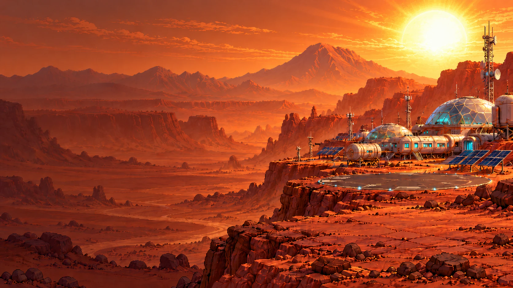
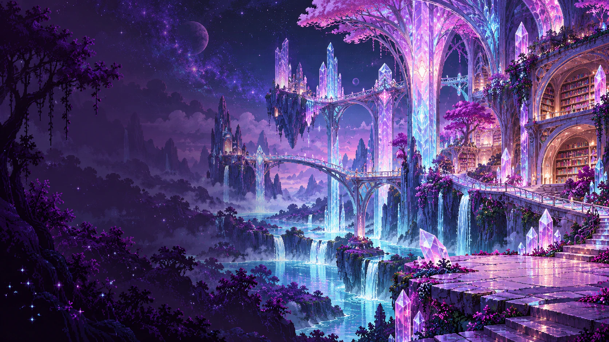
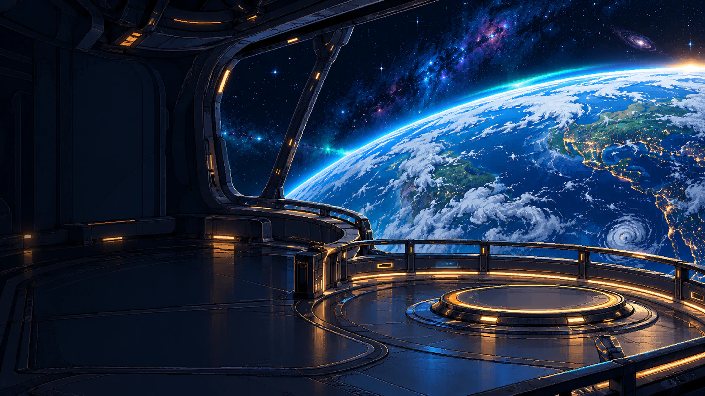
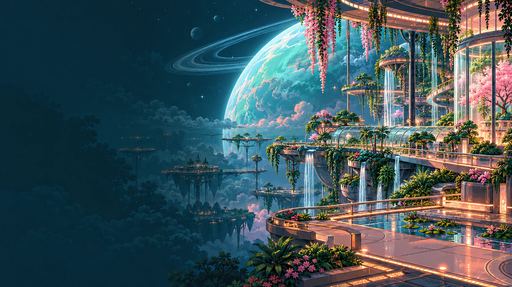
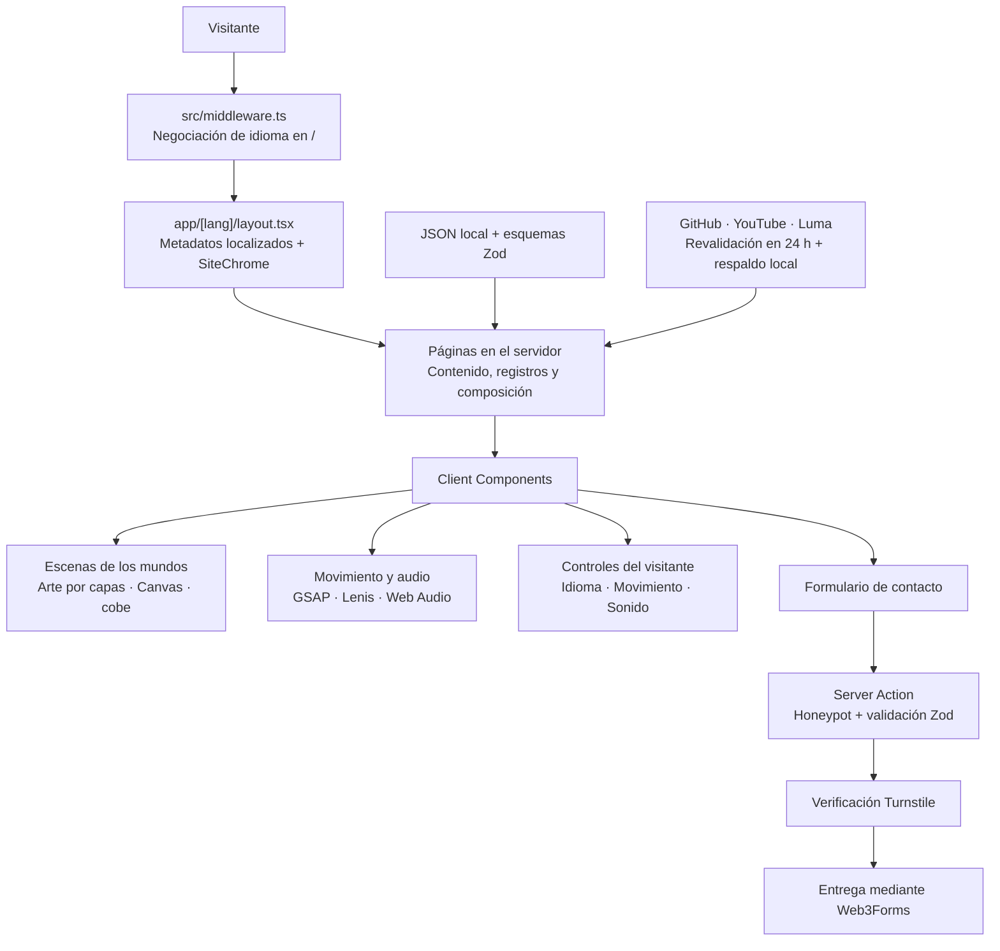

<div align="center">

[English](README.md) · [Português](README.pt-BR.md) · **Español**

# Galáxia Encantada

### El portafolio de Glaucia Lemos. Un universo por explorar.

Ingeniería, liderazgo e IA cobran vida en un universo original de pixel art.

[**Entra en la galaxia →**](https://glaucialemos.dev/es) · [Conoce los mundos](#worlds) · [La ingeniería por dentro](#architecture) · [Ejecútalo localmente](#getting-started)

[](https://github.com/glaucia86/glaucialemos.dev/actions/workflows/ci.yml)


<a href="https://glaucialemos.dev/es">
  
</a>

<sub>Observatório das Primeiras Luzes. El paisaje es la base; personajes, clima e interacciones son capas independientes.</sub>

</div>

---

Una carrera se convierte en expedición. Los proyectos tienen su laboratorio en Marte. Los artículos habitan una biblioteca de cristales. Los eventos iluminan la Tierra vista desde la órbita.

**glaucialemos.dev** es el portafolio personal de Glaucia Lemos, construido como un universo original llamado **Galáxia Encantada**. Glaucia y su perro, **Prince**, acompañan a quienes lo visitan por seis mundos públicos, cada uno con su propia dirección artística, atmósfera y forma de contar una historia.

Detrás de los escenarios hay repositorios, registros de trayectoria, publicaciones, participaciones en eventos y servicios reales. Puedes llegar por el trabajo, quedarte por el viaje y elegir cuánto movimiento y sonido acompañan la experiencia.

> Este README presenta los paisajes y la ingeniería. Los descubrimientos te esperan en el sitio.

<a id="worlds"></a>

## Seis mundos. Un viaje conectado.

<table>
  <tr>
    <td width="50%" valign="top">
      <a href="https://glaucialemos.dev/es"></a>
      <h3>01 · Observatório das Primeiras Luzes</h3>
      <p><b>Inicio · Tierra</b><br />Una presentación de la ingeniera, su trabajo y la tripulación, bajo un cielo con vida propia.</p>
    </td>
    <td width="50%" valign="top">
      <a href="https://glaucialemos.dev/es/sobre"></a>
      <h3>02 · Nivéora</h3>
      <p><b>Sobre mí · El mundo de la nieve y las auroras</b><br />Etapas de trayectoria, hitos y un diario de expedición formado por años de ingeniería y educación.</p>
    </td>
  </tr>
  <tr>
    <td width="50%" valign="top">
      <a href="https://glaucialemos.dev/es/projetos"></a>
      <h3>03 · Marte, Vale das Invenções</h3>
      <p><b>Proyectos · El valle de las invenciones</b><br />Un laboratorio de repositorios de código abierto, telemetría de GitHub, contribuciones y experimentos de ingeniería.</p>
    </td>
    <td width="50%" valign="top">
      <a href="https://glaucialemos.dev/es/conteudo"></a>
      <h3>04 · Lúmina, a Biblioteca Viva</h3>
      <p><b>Contenido · La biblioteca viva</b><br />Artículos organizados por año, idioma y plataforma, con colecciones seleccionadas y conexiones entre publicaciones.</p>
    </td>
  </tr>
  <tr>
    <td width="50%" valign="top">
      <a href="https://glaucialemos.dev/es/eventos"></a>
      <h3>05 · Atlas das Conexões</h3>
      <p><b>Eventos · Órbita terrestre</b><br />Un globo interactivo, un diario de eventos y las próximas conexiones. La presencia física y la participación remota cuentan historias distintas.</p>
    </td>
    <td width="50%" valign="top">
      <a href="https://glaucialemos.dev/es/servicos"></a>
      <h3>06 · Aurélia, os Jardins Suspensos</h3>
      <p><b>Servicios · Los jardines colgantes</b><br />Talleres, mentorías, charlas y una experiencia cinematográfica de contacto para la próxima colaboración.</p>
    </td>
  </tr>
</table>

Estos son los destinos públicos implementados. Incluso una URL perdida tiene su propio escenario: **Maré Rubra**, la experiencia de error 404.

| Página | Ruta |
| --- | --- |
| Entrada por idioma | `/` → `/pt`, `/en` o `/es`, según `Accept-Language` |
| Inicio | `/[lang]` |
| Sobre mí | `/[lang]/sobre` |
| Proyectos | `/[lang]/projetos` |
| Contenido | `/[lang]/conteudo` |
| Eventos | `/[lang]/eventos` |
| Servicios | `/[lang]/servicos` |
| Coordenadas perdidas | Rutas inexistentes → 404 localizado |

Los slugs de las rutas son iguales en los tres idiomas. El selector de idioma conserva la ruta de la página.

<a id="experience"></a>

## Lo que da vida a la galaxia

- **Una atmósfera propia en cada mundo.** Los motores de Canvas dibujan estrellas, auroras, nieve, polvo, luz de cristales y pétalos. Las transiciones de desplazamiento siguen el lenguaje visual de cada escenario.
- **Un elenco compuesto por capas.** Poses aprobadas, sprites transparentes, capas de parpadeo y objetos anclados sitúan a Glaucia y Prince dentro de cada escena.
- **Movimiento con dirección.** GSAP coordina timelines, texto, trazados SVG, arrastre y coreografías de desplazamiento. Lenis comparte su ticker; los ciclos de las escenas se pausan fuera de pantalla o cuando la pestaña está oculta.
- **Una banda sonora para el viaje.** Cada mundo principal tiene su música, junto con ambientes, efectos grabados y sonidos sintetizados con Web Audio. El audio empieza apagado; música y efectos tienen controles de volumen separados.
- **Contenido profesional para consultar.** Búsqueda de repositorios, estanterías de artículos, etapas de trayectoria, diario de eventos y detalles de servicios siguen siendo centrales en cada página.
- **El contacto forma parte de la escena.** Aurélia abre el formulario en un portal, guía el proceso en tres pasos y representa visualmente el resultado del envío. La solicitud real pasa por una Server Action con validación.
- **Exploración a tu ritmo.** La radio Comlink del encabezado hace accesible la exploración opcional mediante teclado y toque, con progreso guardado localmente.

<a id="architecture"></a>

## La ingeniería detrás de los escenarios

**Las páginas del App Router de Next.js obtienen y preparan el contenido en el servidor. Los Client Components añaden interacción, animación y medios del navegador alrededor de ese contenido.** Los módulos de dominio transforman registros en líneas de tiempo, estanterías, telemetría y mapas; los componentes de cada mundo dan identidad visual a esos registros.



| Límite | Responsabilidad |
| --- | --- |
| `src/app/[lang]/` | Páginas localizadas, metadatos, renderizado en el servidor y composición |
| `src/lib/data.ts` + `types.ts` | Validar los registros locales con Zod antes de llegar a la interfaz |
| `src/lib/*-records.ts` | Derivar el contenido factual de cada mundo a partir de esos registros |
| `src/lib/scenes.ts` + `src/data/galaxia/` | Geometría de escenas, anclajes de poses y metadatos de los recursos generados |
| `src/lib/gsap.ts`, `motion.ts`, `use-motion.ts` | Configuración de animaciones, preferencias y ciclo de visibilidad |
| `src/lib/sfx.ts` + `music.ts` | Efectos, ambientes, música y preferencias de volumen, siempre opcionales |
| `src/app/actions/contact.ts` | Validar y entregar las solicitudes de contacto en el servidor |

No hay una base de datos de la aplicación que aprovisionar. Los datos editoriales y las instantáneas de respaldo viven en el repositorio; las preferencias y el progreso de exploración se guardan en el navegador del visitante.

### Stack

| Capa | Implementación |
| --- | --- |
| Aplicación | Next.js 15 · React 19 · TypeScript con `strict` habilitado |
| Presentación | Tailwind CSS 4 · tokens semánticos de CSS · estilos propios por mundo |
| Movimiento | GSAP 3 · `@gsap/react` · ScrollTrigger · SplitText · DrawSVG · Draggable · Lenis |
| Gráficos | Motores Canvas 2D · SVG · CSS 3D · globo WebGL con cobe |
| Audio y vídeo | Web Audio API · audio/vídeo HTML · efectos Ogg/MP3 · vídeo WebM/MP4 |
| Contenido y formularios | Zod 4 · React Server Actions · Cloudflare Turnstile · Web3Forms |
| Verificación | ESLint · TypeScript · Vitest · Playwright |
| Fuentes | Geist · Geist Mono · Departure Mono, servidas localmente con `next/font/local` |

### Registros reales e integraciones con respaldo

| Fuente | Qué alimenta | Si falla la red |
| --- | --- | --- |
| GitHub | Clasificación y archivo de repositorios, perfil y telemetría de contribuciones | Instantáneas locales de proyectos y GitHub |
| RSS público de YouTube | Última publicación larga del canal, con filtro de Shorts | `src/data/youtube.json` |
| Endpoint público del perfil de Luma | Próximos eventos organizados | `src/data/luma.json`, filtrado a fechas futuras |
| JSON local seleccionado | Trayectoria, artículos, historial de eventos, contribuciones y servicios | Disponible directamente en el repositorio |

Las integraciones de red revalidan los datos cada 24 horas. El endpoint de Luma no está documentado; el respaldo local forma parte de la integración. Su script de instantáneas informa de eventos ausentes del historial seleccionado sin añadirlos automáticamente.

**El mapa representa la presencia con precisión:** los eventos remotos son señales, nunca marcadores de ciudades visitadas. Los países con participación presencial se cuentan por separado de los representados remotamente. Eventos utiliza filtros GET que también funcionan sin JavaScript; la versión mejorada actualiza los resultados en la misma página.

<a id="accessibility"></a>

## Hecho para quien está a los controles

- La preferencia del sistema `prefers-reduced-motion` y la elección manual del sitio controlan las animaciones.
- El HTML del servidor empieza con contenido legible; el movimiento se activa tras la hidratación. Los diseños con movimiento reducido conservan la información de forma estática.
- La interfaz incluye salto al contenido, foco visible, controles etiquetados y alternativas táctiles.
- El portal de contacto gestiona el foco, admite Escape y devuelve el foco al cerrarse.
- Los diálogos y paneles señalados mantienen su desplazamiento nativo mientras Lenis gestiona la página.
- El sonido empieza apagado. Música y ambientes responden a la visibilidad de la página; las preferencias de audio persisten localmente.
- El formulario de contacto se presenta completo antes de la hidratación y pasa a tres pasos cuando está habilitado. **El envío requiere JavaScript para Turnstile**; LinkedIn sigue disponible como alternativa de contacto.

Navegador, teclado, tecnologías de asistencia y revisión visual siguen formando parte de la validación.

<a id="getting-started"></a>

## Ejecuta la expedición localmente

Utiliza **Node.js 22**, la versión definida en CI, y npm.

```bash
git clone https://github.com/glaucia86/glaucialemos.dev.git
cd glaucialemos.dev
npm ci
npm run dev
```

Abre [localhost:3000](http://localhost:3000). La raíz selecciona un idioma; también puedes abrir `/pt`, `/en` o `/es` directamente.

### Configuración opcional del entorno

El portafolio funciona sin credenciales. El envío de contacto necesita las tres claves de contacto.

```bash
# macOS / Linux
cp .env.example .env.local
```

```powershell
# Windows / PowerShell
Copy-Item .env.example .env.local
```

| Variable | Finalidad |
| --- | --- |
| `WEB3FORMS_ACCESS_KEY` | Credencial del servidor para entregar el contacto |
| `TURNSTILE_SECRET_KEY` | Credencial del servidor para verificar el desafío |
| `TURNSTILE_SITE_KEY` | Clave pública del widget, leída por el servidor y enviada al componente |
| `GITHUB_TOKEN` | Token opcional del servidor para ampliar el límite de la API de GitHub; añádelo a `.env.local` si lo necesitas |

Mantén las credenciales del servidor fuera de las variables `NEXT_PUBLIC_*`. Reinicia el servidor local tras cambiar el entorno. Sin las claves de contacto, los campos y el envío quedan deshabilitados y LinkedIn permanece disponible.

Autoriza tu hostname en Turnstile y configura el destinatario en Web3Forms. La integración actual envía desde el servidor; [Web3Forms exige un plan de pago y autorización de las IP del servidor para este uso](https://docs.web3forms.com/getting-started/api-reference).

<a id="verification"></a>

## Verificación y producción

| Comando | Finalidad |
| --- | --- |
| `npm run dev` | Desarrollo local |
| `npm run lint` | ESLint |
| `npm run typecheck` | TypeScript sin emitir JavaScript |
| `npm test` | Suites unitarias de Vitest |
| `npm run build` | Build de producción |
| `npm run start` | Servir un build de producción existente |
| `npm run test:browser` | Ejecutor de navegador; inicia el servidor de producción si `BASE_URL` no está definido |

[GitHub Actions](.github/workflows/ci.yml) ejecuta instalación, lint, typecheck, pruebas unitarias y build en los pushes a `main` y `feat/**` y en las PR dirigidas a `main`. Las suites de navegador se ejecutan por separado.

```bash
npm run lint
npm run typecheck
npm test
npm run build
```

**Detén el servidor de desarrollo antes del build:** ambos usan `.next`. La salida de producción debe incluir `ƒ Middleware`.

Para verificar en el navegador, ejecuta estos comandos por tu cuenta después del build:

```bash
npx playwright install chromium
npm run test:browser -- atlas aurelia
```

El ejecutor acepta nombres de suites y normalmente utiliza el puerto `3100`. Para reutilizar tu propio servidor, define `BASE_URL`:

```bash
# macOS / Linux
BASE_URL=http://127.0.0.1:3100 node tests/atlas.browser.mjs
```

```powershell
# Windows / PowerShell
$env:BASE_URL = "http://127.0.0.1:3100"
node tests/atlas.browser.mjs
```

Las pruebas de contacto en el navegador simulan la entrega. La revisión manual de imagen y sonido complementa las suites automáticas. En Windows, comprueba `netstat -ano` si un servidor Next detenido sigue ocupando el puerto.

<a id="art-pipeline"></a>

## Del arte aprobado a una escena viva

```text
Fuentes aprobadas → recorte y limpieza del fondo → cuadrícula y paleta
                 → capas WebP transparentes + JSON de la escena
                 → composición anclada + movimiento + atmósfera en Canvas
```

El pipeline Node/Sharp conserva los fondos aprobados mientras procesa las capas de personajes y objetos. Los metadatos de las escenas mantienen dimensiones lógicas, dimensiones de los píxeles exportados y anclajes, para que un cambio de pose siga unido al punto correcto de la composición.

```bash
node scripts/build-galaxia-assets.mjs niveora --debug
node scripts/build-galaxia-assets.mjs --manifest
```

| Ubicación | Función |
| --- | --- |
| `docs/art/galaxia-encantada/approved-source/` | Fondos, hojas de personajes y objetos aprobados |
| `docs/art/galaxia-encantada/manifest.json` | Inventario de fuentes con hashes SHA-256 |
| `src/data/galaxia/layout.json` | Cuadrícula, paletas, escalas y posiciones por escena |
| `public/galaxia/` | Fondos, sprites, objetos y medios exportados |
| `src/data/galaxia/` | Metadatos generados y consumidos por la aplicación |

Los recursos generados están versionados, por lo que ejecutar el sitio no requiere regenerar el arte.

<a id="project-map"></a>

## Encuentra tu camino en el repositorio

```text
src/
├── app/
│   ├── [lang]/          Páginas y layouts localizados
│   ├── actions/         Server Action de contacto
│   └── *.css            Tokens, estilos de mundos e interfaz compartida
├── components/          Escenas, secciones de página y controles compartidos
│   └── motion/          Desplazamiento suave y efectos de interacción compartidos
├── data/                Registros seleccionados, instantáneas y metadatos de escenas
├── i18n/                Diccionarios y textos de mundos en PT, EN y ES
├── lib/                 Dominio, integraciones y controladores del navegador
└── middleware.ts        Negociación de idioma en la raíz
public/
├── galaxia/             Arte y medios de las escenas
├── music/               Bandas sonoras de los mundos
└── sfx/                 Efectos grabados y ambientes
scripts/                 Pipeline de recursos y mantenimiento de instantáneas
tests/                   Pruebas unitarias y suites de navegador de ejecución manual
```

Para mantenimiento, comienza por [AGENTS.md](AGENTS.md) y el [handoff de implementación](docs/galaxia-encantada/HANDOFF.md). El [sistema de diseño](DESIGN-SYSTEM.md), el [registro de decisiones](DECISOES.md) y el [plan de migración](docs/galaxia-encantada/PLANO-MIGRACAO.md) conservan la historia del proyecto; las entradas antiguas pueden describir un diseño anterior. Los documentos de mantenimiento incluyen detalles de implementación de la narrativa.

<a id="credits"></a>

## Hecho por Glaucia. Explorado con Prince.

**Glaucia Lemos** conecta ingeniería de software, educación técnica, liderazgo e IA. Este portafolio reúne ese trabajo en un universo con identidad visual propia y un copiloto de cuatro patas.

[GitHub](https://github.com/glaucia86) · [LinkedIn](https://www.linkedin.com/in/glaucialemos) · [YouTube](https://www.youtube.com/@GlauciaLemos) · [Próximos eventos](https://luma.com/user/glaucia_lemos86)

Dirección creativa y aprobación: **Glaucia Lemos**. El arte de los mundos se produjo con asistencia de IA mediante Grok Image y se revisó antes de integrarse.

- Los efectos grabados y los ambientes tienen sus propias [fuentes y créditos CC0](public/sfx/CREDITS.md).
- La música de los mundos se creó en Manus y se proporcionó para este proyecto; sus [notas de uso](public/music/CREDITS.md) son independientes de los efectos CC0.
- Departure Mono es de Helena Zhang, bajo [SIL OFL 1.1](src/app/fonts/DepartureMono-LICENSE.txt).
- Solicita autorización antes de reutilizar el arte o los textos del portafolio; las licencias de recursos de terceros no conceden derechos generales sobre todo el proyecto.

<div align="center">

**El código está aquí. El viaje te espera.**

[Explora Galáxia Encantada →](https://glaucialemos.dev/es)

<sub>glaucialemos.dev · Sigue explorando.</sub>

</div>
