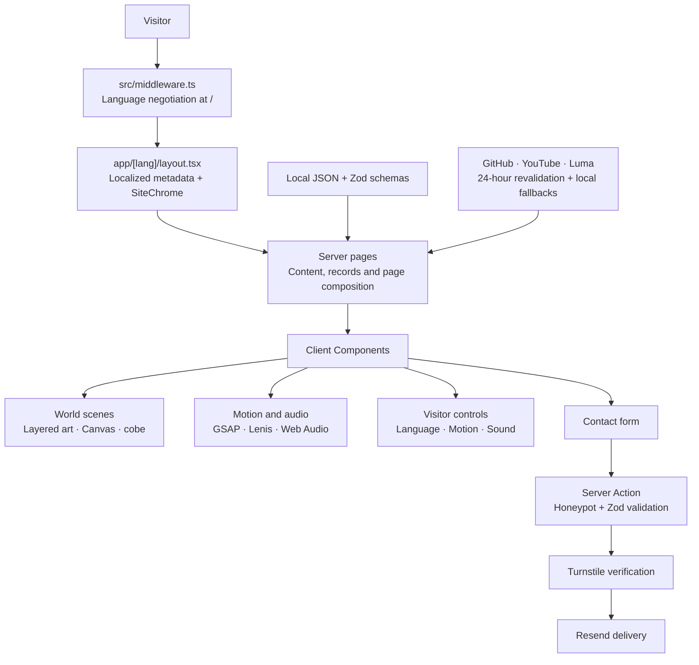

<div align="center">

**English** · [Português](README.pt-BR.md) · [Español](README.es.md)

# Galáxia Encantada

### Glaucia Lemos's portfolio. A universe you can explore.

# [glaucialemos.dev](https://glaucialemos.dev/)

[**Enter the galaxy →**](https://glaucialemos.dev/en) · [Explore the worlds](#worlds) · [Under the hood](#architecture) · [Run locally](#getting-started)

[](https://github.com/glaucia86/glaucialemos.dev/actions/workflows/ci.yml)


<a href="https://glaucialemos.dev/en">
  
</a>

<sub>Observatório das Primeiras Luzes. The landscape is the backdrop; characters, weather and interactions are separate layers.</sub>

</div>

---

A career becomes an expedition. Projects become a laboratory on Mars. Articles live in a crystalline library. Events illuminate the Earth from orbit.

**glaucialemos.dev** is Glaucia Lemos's personal portfolio, built as an original universe called **Galáxia Encantada**. Glaucia and her dog, **Prince**, accompany visitors through six public worlds, each with its own art direction, atmosphere and way of telling a story.

Behind the scenery are real repositories, career records, publications, speaking engagements and services. You can come for the work, stay for the journey, and choose how much motion and sound comes along.

> This README gives you the landscapes and the engineering. The discoveries are yours to make on the site.

## What's new · November 2026 release (`v2026.11.0`)

- **Clearer offer, easier contact.** A literal menu (Home · Crew · Projects · Events · Workshops & mentoring · Content), one "Request a proposal for my team" button across the site with a reply-time promise, a sticky call to action on reading pages, and a contact form that now delivers through **Resend** (Turnstile and Zod validation kept).
- **Real social proof.** An approved portrait, a talk photo, the companies Glaucia worked with, the events where she spoke (with sources), a full BrazilJS talk you can watch in place, and a first-party testimonial form with manual approval.
- **Formats and talk topics with life.** Pixel-art glyphs, a colour per format and light that follows the pointer; PDLC/SDLC workshops for any stack, Spec-Driven Development, Context and Harness Engineering.
- **A seven-world jump.** Near the end of Home, the scroll becomes a hyperspace trip through every world's real plate, landing on the proposal button.
- **50 secrets.** The galaxy now hides 50 discoveries. Home explains what they unlock, and the Comlink radio guides the way to the 2 secret pages.
- **A narrated epilogue episode** with captions in three languages, unlocked by the last light.

<a id="worlds"></a>

## Six worlds. One connected journey.

<table>
  <tr>
    <td width="50%" valign="top">
      <a href="https://glaucialemos.dev/en"></a>
      <h3>01 · Observatório das Primeiras Luzes</h3>
      <p><b>Home · Earth</b><br />An introduction to the engineer, the work and the crew, beneath a living night sky.</p>
    </td>
    <td width="50%" valign="top">
      <a href="https://glaucialemos.dev/en/sobre"></a>
      <h3>02 · Nivéora</h3>
      <p><b>About · The world of snow and auroras</b><br />Career chapters, milestones and an expedition log shaped by years of engineering and education.</p>
    </td>
  </tr>
  <tr>
    <td width="50%" valign="top">
      <a href="https://glaucialemos.dev/en/projetos"></a>
      <h3>03 · Marte, Vale das Invenções</h3>
      <p><b>Projects · The invention valley</b><br />A working laboratory of open-source repositories, GitHub telemetry, contributions and engineering experiments.</p>
    </td>
    <td width="50%" valign="top">
      <a href="https://glaucialemos.dev/en/conteudo"></a>
      <h3>04 · Lúmina, a Biblioteca Viva</h3>
      <p><b>Content · The living library</b><br />Articles organized by year, language and platform, with curated collections and connected publications.</p>
    </td>
  </tr>
  <tr>
    <td width="50%" valign="top">
      <a href="https://glaucialemos.dev/en/eventos"></a>
      <h3>05 · Atlas das Conexões</h3>
      <p><b>Events · Earth orbit</b><br />An interactive globe, an event journal and upcoming connections. In-person presence and remote participation tell distinct stories.</p>
    </td>
    <td width="50%" valign="top">
      <a href="https://glaucialemos.dev/en/servicos"></a>
      <h3>06 · Aurélia, os Jardins Suspensos</h3>
      <p><b>Services · The hanging gardens</b><br />Workshops, mentoring, talks and a cinematic contact experience for the next collaboration.</p>
    </td>
  </tr>
</table>

These are the implemented public destinations. Even a missing URL has its own setting: **Maré Rubra**, the custom 404 experience.

| Page | Route |
| --- | --- |
| Language entry point | `/` → `/pt`, `/en` or `/es`, using `Accept-Language` |
| Home | `/[lang]` |
| About | `/[lang]/sobre` |
| Projects | `/[lang]/projetos` |
| Content | `/[lang]/conteudo` |
| Events | `/[lang]/eventos` |
| Services | `/[lang]/servicos` |
| Missing coordinates | Unmatched routes → localized 404 |

Route slugs stay the same in all three languages. The language switch preserves the page path.

<a id="experience"></a>

## What makes the galaxy feel alive

- **A different atmosphere in every world.** Canvas engines draw stars, auroras, snow, dust, crystal light and petals. Scroll transitions follow each world's visual language.
- **A cast assembled in layers.** Approved character poses, transparent sprites, blink overlays and anchored props give Glaucia and Prince a place in each scene.
- **Motion with direction.** GSAP handles timelines, text, SVG paths, dragging and scroll choreography. Lenis shares its ticker; scene lifecycles pause work outside the viewport or in hidden tabs.
- **A soundtrack for the journey.** Each main world has a music track, alongside ambience, recorded effects and synthesized Web Audio sounds. Audio starts off; music and effects have separate volume controls.
- **Professional content you can use.** Searchable repositories, article shelves, career eras, an event journal and service details remain central to each page.
- **Contact becomes part of the scene.** Aurélia opens the form in a portal, guides visitors through three steps and visualizes the submission result. The actual request goes through a validated Server Action.
- **Exploration on your terms.** The header's Comlink radio brings optional exploration to keyboard and touch users, with locally saved progress.

<a id="architecture"></a>

## The engineering behind the scenery

**Next.js App Router pages fetch and prepare content on the server. Client Components add interaction, animation and browser media around that content.** Domain modules turn records into timelines, shelves, telemetry and maps; world components give those records a visual identity.



| Boundary | Responsibility |
| --- | --- |
| `src/app/[lang]/` | Localized pages, metadata, server rendering and composition |
| `src/lib/data.ts` + `types.ts` | Validate local records with Zod before they reach the UI |
| `src/lib/*-records.ts` | Derive each world's factual content from those records |
| `src/lib/scenes.ts` + `src/data/galaxia/` | Scene geometry, pose anchors and generated asset metadata |
| `src/lib/gsap.ts`, `motion.ts`, `use-motion.ts` | Shared animation setup, preferences and visibility lifecycle |
| `src/lib/sfx.ts` + `music.ts` | Opt-in effects, ambience, music and volume preferences |
| `src/app/actions/contact.ts` | Validate and deliver contact requests on the server |

There is no application database to provision. Editorial data and fallback snapshots live in the repository; preferences and exploration progress live in the visitor's browser.

### Stack

| Layer | Implementation |
| --- | --- |
| Application | Next.js 15 · React 19 · TypeScript with `strict` enabled |
| Presentation | Tailwind CSS 4 · semantic CSS tokens · dedicated world stylesheets |
| Motion | GSAP 3 · `@gsap/react` · ScrollTrigger · SplitText · DrawSVG · Draggable · Lenis |
| Graphics | Canvas 2D engines · SVG · CSS 3D · cobe WebGL globe |
| Audio and video | Web Audio API · HTML audio/video · Ogg/MP3 effects · WebM/MP4 video |
| Content and forms | Zod 4 · React Server Actions · Cloudflare Turnstile · Resend |
| Verification | ESLint · TypeScript · Vitest · Playwright |
| Fonts | Geist · Geist Mono · Departure Mono, served locally with `next/font/local` |

### Real records, resilient integrations

| Source | What it powers | When the network fails |
| --- | --- | --- |
| GitHub | Repository rankings, archive, profile and contribution telemetry | Local project and GitHub snapshots |
| YouTube public RSS | Latest long-form channel upload, with Shorts filtering | `src/data/youtube.json` |
| Luma public profile endpoint | Upcoming hosted events | `src/data/luma.json`, filtered to future dates |
| Curated local JSON | Career, articles, speaking history, contributions and services | Available directly from the repository |

Live integrations revalidate every 24 hours. Luma's endpoint is undocumented; the saved fallback is part of the integration. Its snapshot script reports events missing from the curated history without adding them automatically.

**The map represents presence accurately:** remote events are signals, never visited-city markers. Countries with in-person appearances are counted separately from those represented remotely. Events use GET filters that also work without JavaScript; enhancement updates results in place.

<a id="accessibility"></a>

## Built for the person at the controls

- System `prefers-reduced-motion` and the site's manual motion preference both control enhancement.
- Server HTML starts with readable content; motion activates after hydration. Reduced-motion layouts retain the information in static form.
- The interface includes skip navigation, visible focus, labeled controls and touch alternatives.
- The contact portal manages focus, supports Escape and restores focus when it closes.
- Dialogs and marked panels keep their own native scrolling while Lenis handles the page.
- Sound is off by default. Music and ambience respond to page visibility; audio settings persist locally.
- The contact form renders as one complete form before hydration and becomes a three-step flow when enabled. **Submission requires JavaScript for Turnstile**; LinkedIn remains the fallback contact route.

Browser, keyboard, assistive-technology and visual checks remain part of review.

<a id="getting-started"></a>

## Run the expedition locally

Use **Node.js 22**, the version selected by CI, and npm.

```bash
git clone https://github.com/glaucia86/glaucialemos.dev.git
cd glaucialemos.dev
npm ci
npm run dev
```

Open [localhost:3000](http://localhost:3000). The root selects a language; you can also open `/pt`, `/en` or `/es` directly.

### Optional environment configuration

The portfolio runs without credentials. Contact submission needs all three contact keys.

```bash
# macOS / Linux
cp .env.example .env.local
```

```powershell
# Windows / PowerShell
Copy-Item .env.example .env.local
```

| Variable | Purpose |
| --- | --- |
| `RESEND_API_KEY` | Sending-only Resend key restricted to the verified domain |
| `CONTACT_FROM` | Sender on the verified domain (e.g. `Site <contato@mail.glaucialemos.dev>`) |
| `CONTACT_TO` | Inbox that receives contact and testimonial messages |
| `TURNSTILE_SECRET_KEY` | Server-side credential for challenge verification |
| `TURNSTILE_SITE_KEY` | Public widget key, read by the server and passed to the widget |
| `GITHUB_TOKEN` | Optional server-side token to raise the GitHub API rate limit; add it to `.env.local` if needed |

Keep server credentials out of `NEXT_PUBLIC_*` variables. Restart the local server after changing the environment. Without the contact keys, form inputs and submission are disabled and LinkedIn stays available.

Authorize your hostname in Turnstile and verify the sending domain in Resend (DNS on Vercel: "Auto configure"). Until it is verified, use `onboarding@resend.dev` as the sender: it only delivers to your Resend account email.

<a id="verification"></a>

## Verification and production

| Command | Purpose |
| --- | --- |
| `npm run dev` | Local development |
| `npm run lint` | ESLint |
| `npm run typecheck` | TypeScript without emitting JavaScript |
| `npm test` | Vitest unit suites |
| `npm run build` | Production build |
| `npm run start` | Serve an existing production build |
| `npm run test:browser` | Browser runner; starts a production server unless `BASE_URL` is set |

[GitHub Actions](.github/workflows/ci.yml) runs installation, lint, typecheck, unit tests and build on pushes to `main` and `feat/**`, and on pull requests targeting `main`. Browser suites run separately.

```bash
npm run lint
npm run typecheck
npm test
npm run build
```

**Stop the dev server before building:** both use `.next`. The production output should include `ƒ Middleware`.

For browser verification, run these commands yourself after building:

```bash
npx playwright install chromium
npm run test:browser -- atlas aurelia
```

The runner accepts suite names and normally uses port `3100`. To reuse your own server, set `BASE_URL`:

```bash
# macOS / Linux
BASE_URL=http://127.0.0.1:3100 node tests/atlas.browser.mjs
```

```powershell
# Windows / PowerShell
$env:BASE_URL = "http://127.0.0.1:3100"
node tests/atlas.browser.mjs
```

Contact browser tests mock delivery. Manual visual and audio review complements the automated suites. On Windows, check `netstat -ano` if a stopped Next server leaves its port occupied.

<a id="art-pipeline"></a>

## From approved artwork to a living scene

```text
Approved sources → crop and background cleanup → pixel grid and palette
                 → transparent WebP layers + scene JSON
                 → anchored composition + motion + Canvas atmosphere
```

The Node/Sharp pipeline preserves approved background plates while processing character and prop layers. Scene metadata keeps logical dimensions, exported pixel dimensions and anchors, so a pose change stays attached to the right point in the composition.

```bash
node scripts/build-galaxia-assets.mjs niveora --debug
node scripts/build-galaxia-assets.mjs --manifest
```

| Location | Role |
| --- | --- |
| `docs/art/galaxia-encantada/approved-source/` | Approved source plates, character sheets and props |
| `docs/art/galaxia-encantada/manifest.json` | Source inventory with SHA-256 hashes |
| `src/data/galaxia/layout.json` | Per-scene grid, palettes, scales and placement |
| `public/galaxia/` | Exported backgrounds, sprites, props and media |
| `src/data/galaxia/` | Generated metadata consumed by the application |

These generated assets are committed, so running the website does not require regenerating the artwork.

<a id="project-map"></a>

## Find your way around the repository

```text
src/
├── app/
│   ├── [lang]/          Localized pages and layouts
│   ├── actions/         Contact Server Action
│   └── *.css            Design tokens, world styles and shared UI
├── components/          World scenes, page sections and shared controls
│   └── motion/          Smooth scrolling and shared interaction effects
├── data/                Curated records, snapshots and scene metadata
├── i18n/                PT, EN and ES dictionaries and world copy
├── lib/                 Domain logic, integrations and browser controllers
└── middleware.ts        Language negotiation at the root
public/
├── galaxia/             Artwork and scene media
├── music/               World soundtracks
└── sfx/                 Recorded sound effects and ambience
scripts/                 Asset pipeline and snapshot maintenance
tests/                   Unit tests and user-run browser suites
```

For maintenance, start with [AGENTS.md](AGENTS.md) and the [implementation handoff](docs/galaxia-encantada/HANDOFF.md). The [design system](DESIGN-SYSTEM.md), [decision log](DECISOES.md) and [migration plan](docs/galaxia-encantada/PLANO-MIGRACAO.md) retain project history; older entries may describe an earlier design. Maintenance documents include narrative implementation details.

<a id="credits"></a>

## Made by Glaucia. Explored with Prince.

**Glaucia Lemos** connects software engineering, technical education, leadership and AI. This portfolio brings that work together in a universe with its own visual identity and a four-legged copilot.

[GitHub](https://github.com/glaucia86) · [LinkedIn](https://www.linkedin.com/in/glaucialemos) · [YouTube](https://www.youtube.com/@GlauciaLemos) · [Upcoming events](https://luma.com/user/glaucia_lemos86)

Creative direction and approval: **Glaucia Lemos**. World artwork was produced with AI assistance using Grok Image and reviewed before integration.

- Recorded effects and ambience have their own [source and CC0 credits](public/sfx/CREDITS.md).
- World music was created in Manus and supplied for this project; its [usage notes](public/music/CREDITS.md) are separate from the CC0 effects.
- Departure Mono is by Helena Zhang, under [SIL OFL 1.1](src/app/fonts/DepartureMono-LICENSE.txt).
- Please ask before reusing the portfolio's artwork or texts; third-party asset licenses do not grant blanket rights to the entire project.

<div align="center">

**The code is here. The journey is waiting.**

[Explore Galáxia Encantada →](https://glaucialemos.dev/en)

<sub>glaucialemos.dev · Keep exploring.</sub>

</div>
