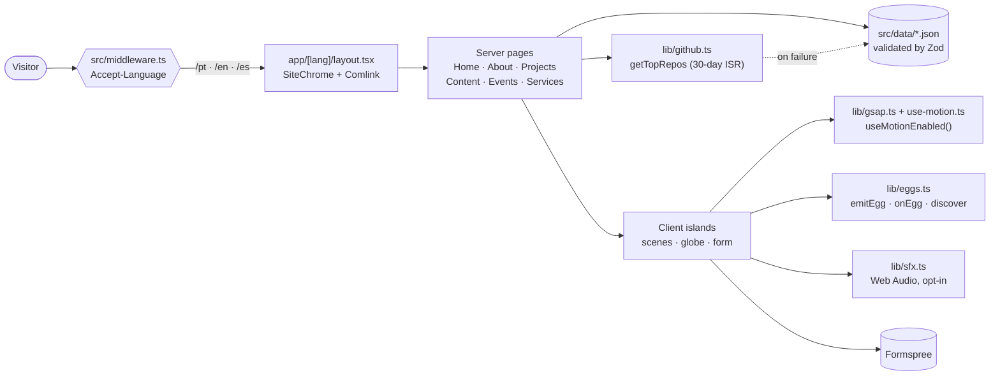

<div align="center">

**English** · [Português](README.pt-BR.md) · [Español](README.es.md)

<br />

<pre>
   ██████╗ ██╗         ·  HOLONET v4.2 // establishing secure link
  ██╔════╝ ██║         ·  loading profile: GLAUCIA_LEMOS
  ██║  ███╗██║         ·  class: Principal Software Engineer
  ██║   ██║██║         ·         AI Transformation Lead · Microsoft MVP · Codex
  ╚██████╔╝███████╗    ·  ACCESS GRANTED
   ╚═════╝ ╚══════╝
</pre>

# glaucialemos.dev

### *A personal website told as a HoloNet transmission, in pixel art, from a galaxy far, far away.*

[](https://github.com/glaucia86/glaucialemos.dev/actions/workflows/ci.yml)


[](https://github.com/glaucia86/glaucialemos.dev/stargazers)


<br />


<sub>Episode I — The Origin. Click to push the rocks, hold to use the Force.</sub>

</div>

---

> **A long time ago, in a repository far, far away...**
>
> A developer turned global educator needed a home on the HoloNet. Not a template,
> not a résumé in a box, but a place where **engineering, leadership and AI** could be
> told as a story. Armed with Next.js, a pixel palette and a stubborn love for
> accessibility, she set out to build a site that feels like a film and reads like a
> well-written doc...

---

## Table of contents

- [glaucialemos.dev](#glaucialemosdev)
    - [*A personal website told as a HoloNet transmission, in pixel art, from a galaxy far, far away.*](#a-personal-website-told-as-a-holonet-transmission-in-pixel-art-from-a-galaxy-far-far-away)
  - [Table of contents](#table-of-contents)
  - [About the project](#about-the-project)
  - [Highlights](#highlights)
  - [Gallery](#gallery)
  - [Tech stack](#tech-stack)
  - [Architecture](#architecture)
  - [Getting started](#getting-started)
    - [Prerequisites](#prerequisites)
    - [Windows](#windows)
    - [macOS](#macos)
    - [Linux](#linux)
      - [Production build (all systems)](#production-build-all-systems)
    - [Environment variables](#environment-variables)
  - [Available scripts](#available-scripts)
  - [Testing](#testing)
  - [Project structure](#project-structure)
  - [Easter egg hunt](#easter-egg-hunt)
  - [Further reading](#further-reading)
  - [Credits and disclaimer](#credits-and-disclaimer)
  - [About me](#about-me)

---

## About the project

**glaucialemos.dev** is the personal website and portfolio of **Glaucia Lemos**, Principal
Software Engineer and AI Transformation Lead. Every page is a scene from a different planet,
and the Home is narrated as a five-episode **HoloNet transmission**:

| Route | Scene | What you will find |
| --- | --- | --- |
| `/` | — | Picks `/pt`, `/en` or `/es` from your `Accept-Language` header |
| `/[lang]` | Dagobah, with Yoda | The five-episode HoloNet story, stats, projects and contact |
| `/[lang]/sobre` | Echo Base, on Hoth | Career trajectory with parallel tracks, Leia and C-3PO |
| `/[lang]/projetos` | Tatooine, with R2-D2 | Live GitHub telemetry, a filterable archive and the Microsoft Squadron of contributions |
| `/[lang]/conteudo` | Chewbacca | Articles and content with filters |
| `/[lang]/eventos` | Grogu | A draggable globe and a searchable history of 130+ talks |
| `/[lang]/servicos` | Darth Vader | Workshops, mentoring, talks and the contact form |
| `404` | Stormtrooper | A lost route, guarded by the Empire |

## Highlights

- **Cinematic, but never in the way.** GSAP timelines (ScrollTrigger, SplitText, ScrambleText)
  and Lenis smooth scroll power the motion. Navigation never waits for an animation.
- **Motion respects you.** `prefers-reduced-motion` *or* a manual toggle turn every scene
  static, and the choice persists across tabs. Without JavaScript, the site still reads well.
- **Sound is opt-in.** Every effect is synthesized live with the Web Audio API. No audio
  files, and it stays silent until you turn it on.
- **Three languages, one URL scheme.** Switching language swaps only the first URL segment,
  so you stay on the same page.
- **Validated data.** Every JSON dataset (events, projects, career, services) is parsed by Zod
  at load time. An invalid record breaks the build instead of sneaking into production.
- **Live GitHub data.** `getTopRepos` ranks repositories by stars and revalidates every
  30 days, falling back to a local snapshot if the API fails or times out.
- **Layered pixel art.** Leia and Yoda are split into layers by Node scripts, so they can blink,
  shiver, draw a blaster or channel the Force.
- **24 secrets.** A shared easter egg registry, with keyboard, touch-gesture and
  terminal (Comlink) triggers. Every secret can be found on mobile too.

## Gallery

<table>
  <tr>
    <td width="50%"></td>
    <td width="50%"></td>
  </tr>
  <tr>
    <td align="center"><sub><b>Dagobah</b>: hold long enough and an X-wing rises.</sub></td>
    <td align="center"><sub><b>Echo Base</b>: the About page, on the ice planet Hoth.</sub></td>
  </tr>
  <tr>
    <td width="50%"></td>
    <td width="50%"></td>
  </tr>
  <tr>
    <td align="center"><sub><b>Community Jedi</b>: a character sheet that deflects blaster bolts.</sub></td>
    <td align="center"><sub><b>Mobile</b>: every scene and secret, also by touch.</sub></td>
  </tr>
</table>

## Tech stack

| Layer | Choice | Why |
| --- | --- | --- |
| Framework | [Next.js 15](https://nextjs.org/) (App Router) | Server-first pages, i18n routing, ISR for GitHub data |
| UI | [React 19](https://react.dev/) | Client Components only where there is interaction |
| Language | [TypeScript](https://www.typescriptlang.org/) (strict) | Typed data, dictionaries and easter egg ids |
| Styling | [Tailwind CSS 4](https://tailwindcss.com/) + semantic tokens | One palette: purple `#5a3d7e`, magenta `#893866`, orange `#e07828` |
| Motion | [GSAP 3](https://gsap.com/) + [Lenis](https://lenis.darkroom.engineering/) | Pinned scroll, scrub and text effects that work in every browser |
| Globe | [cobe](https://github.com/shuding/cobe) | A lightweight WebGL globe for the Events page |
| Validation | [Zod 4](https://zod.dev/) | Schemas for every dataset |
| Tests | [Vitest](https://vitest.dev/) + [Playwright](https://playwright.dev/) | Unit tests and real-browser suites |
| Fonts | Geist, Geist Mono, Departure Mono | Self-hosted with `next/font/local` |
| Forms | [Formspree](https://formspree.io/) | No personal e-mail in the code |

## Architecture



## Getting started

### Prerequisites

| Tool | Version | Check with |
| --- | --- | --- |
| [Node.js](https://nodejs.org/) | **22 or newer** (CI uses 22) | `node -v` |
| npm | comes with Node | `npm -v` |
| [Git](https://git-scm.com/) | any recent version | `git --version` |

> [!TIP]
> Using a version manager ([nvm](https://github.com/nvm-sh/nvm), [nvm-windows](https://github.com/coreybutler/nvm-windows),
> [fnm](https://github.com/Schniz/fnm) or [Volta](https://volta.sh/)) makes switching to Node 22 a one-liner.

### Windows

**1. Install Node.js LTS and Git** (PowerShell, with [winget](https://learn.microsoft.com/windows/package-manager/winget/)):

```powershell
winget install OpenJS.NodeJS.LTS
winget install Git.Git
```

Restart the terminal so `node` and `git` are on your `PATH`.

**2. Clone and install:**

```powershell
git clone https://github.com/glaucia86/glaucialemos.dev.git
cd glaucialemos.dev
npm ci
Copy-Item .env.example .env.local
```

**3. Start the dev server:**

```powershell
npm run dev
```

Open <http://localhost:3000>. You will be redirected to `/pt`, `/en` or `/es`.

> [!NOTE]
> On Windows, stopping `npm run start` can leave Next's `node` process listening on the port.
> If you get `EADDRINUSE`, find and stop it:
>
> ```powershell
> netstat -ano | findstr :3000
> taskkill /PID <pid> /F
> ```

### macOS

**1. Install Node.js 22 and Git** (with [Homebrew](https://brew.sh/)):

```bash
brew install node@22 git
echo 'export PATH="$(brew --prefix node@22)/bin:$PATH"' >> ~/.zshrc
source ~/.zshrc
```

**2. Clone and install:**

```bash
git clone https://github.com/glaucia86/glaucialemos.dev.git
cd glaucialemos.dev
npm ci
cp .env.example .env.local
```

**3. Start the dev server:**

```bash
npm run dev
```

Open <http://localhost:3000>.

### Linux

**1. Install Node.js 22 with [nvm](https://github.com/nvm-sh/nvm)** (works on any distro):

```bash
curl -o- https://raw.githubusercontent.com/nvm-sh/nvm/v0.40.3/install.sh | bash
source ~/.bashrc
nvm install 22
```

Git: `sudo apt install git` (Debian/Ubuntu), `sudo dnf install git` (Fedora) or `sudo pacman -S git` (Arch).

**2. Clone and install:**

```bash
git clone https://github.com/glaucia86/glaucialemos.dev.git
cd glaucialemos.dev
npm ci
cp .env.example .env.local
```

**3. Start the dev server:**

```bash
npm run dev
```

Open <http://localhost:3000>.

#### Production build (all systems)

```bash
npm run build
npm run start -- --hostname 127.0.0.1 --port 3100
```

### Environment variables

Every variable is **optional**. The site runs without any of them.

| Variable | Where | What it does |
| --- | --- | --- |
| `NEXT_PUBLIC_FORMSPREE_ID` | browser | Formspree form ID. The form posts to `https://formspree.io/f/<id>`. Without it, the form says that sending is unavailable and blocks submission. |
| `GITHUB_TOKEN` | server only | Raises the GitHub API rate limit used to rank repositories by stars. Without it, the site uses the public limit and falls back to `src/data/projetos.json`. |

## Available scripts

| Command | What it does |
| --- | --- |
| `npm run dev` | Starts the dev server with hot reload |
| `npm run build` | Builds for production (check that `ƒ Middleware` is listed) |
| `npm run start` | Serves the production build |
| `npm run lint` | ESLint (`eslint-config-next`) |
| `npm run typecheck` | `tsc --noEmit` |
| `npm test` | Unit tests with Vitest |
| `npm run test:browser` | Playwright suites against a production server |

## Testing

The same checks run in [GitHub Actions](.github/workflows/ci.yml) on every push and pull request:

```bash
npm run lint && npm run typecheck && npm test && npm run build
```

Browser suites cover the hero CTAs, scenes, scene lifecycle, the Events page and Echo Base:

```bash
npx playwright install chromium   # first time only
npm run build
npm run test:browser              # starts a server on port 3100 for you
```

To reuse a server that is already running, point the suites at it:

```bash
# macOS / Linux
BASE_URL=http://127.0.0.1:3100 node tests/holonet.browser.mjs
```

```powershell
# Windows (PowerShell)
$env:BASE_URL = "http://127.0.0.1:3100"; node tests/holonet.browser.mjs
```

## Project structure

```text
glaucialemos.dev/
├── .github/workflows/ci.yml   # lint · typecheck · test · build
├── docs/                      # design notes, art briefs, screenshots
├── public/pixel/              # pixel-art scenes and layered characters
├── scripts/                   # build-leia-layers, build-yoda-force, build-home-map
├── src/
│   ├── app/
│   │   ├── [lang]/            # home, sobre, projetos, conteudo, eventos, servicos
│   │   └── *.css              # tokens, pixel UI, scenes, Jedi effects
│   ├── components/
│   │   ├── home/              # Dagobah, BootSequence, Force particles, hyperspace
│   │   ├── about/             # Echo Base, Leia, C-3PO, CareerMap, EchoEggs
│   │   ├── projects/          # Tatooine: R2Telemetry, RepoArchive, AllianceSquadrons, TatooineEggs
│   │   └── motion/            # FxLayer, SmoothScroll
│   ├── data/                  # events, projects, career, services (JSON + Zod)
│   ├── i18n/                  # pt · en · es dictionaries
│   ├── lib/                   # github, career, eggs, sfx, gsap, use-motion
│   └── middleware.ts          # language detection
└── tests/                     # *.test.ts (Vitest) · *.browser.mjs (Playwright)
```

## Easter egg hunt

The site hides **24 secrets**. Open the **Comlink** (the terminal in the corner of the
screen) to track your progress. Type a code word into it, or straight onto the page.

<details>
<summary><b>Spoilers: a few hints, if the Force is not with you</b></summary>

<br />

| Where | Hint |
| --- | --- |
| Anywhere | A classic code from the 8-bit era, typed or swiped: ↑ ↑ ↓ ↓ ← → ← → B A |
| Home | Click the swamp. Then try holding it for a long time... |
| Home | A Jedi's lightsaber is not only for show |
| Echo Base | The princess has a message for an old general |
| Echo Base | *"I love you."* What would Han answer? |
| Echo Base | Something is watching from the sky. Leia has a blaster. |
| Echo Base | Keep bothering the protocol droid |
| Echo Base | Stand still for a few seconds and feel the cold |
| Tatooine | An old command from 2018 still answers in R2's terminal |
| Tatooine | Two suns, one after the other |
| Tatooine | Hold R2. The plans are in this droid. |
| Tatooine | Search the market for droids. Move along. |
| Tatooine | Small hooded traders roam the horizon: *Utinni!* |
| Tatooine | A certain Skywalker hates sand. A certain BB-8 loves dunes. |

</details>

<sub>On mobile, every secret has an equivalent touch gesture. "Wipe memory" in the Comlink resets your progress.</sub>

## Further reading

| Document | Topic |
| --- | --- |
| [`DESIGN-SYSTEM.md`](DESIGN-SYSTEM.md) | Palette, typography, components, scenes (in Portuguese) |
| [`DECISOES.md`](DECISOES.md) | Architecture decision log, with the reasoning behind each choice (in Portuguese) |
| [`docs/cinematic-home.md`](docs/cinematic-home.md) | Home motion direction and accessibility (in Portuguese) |
| [`docs/dagobah-art.md`](docs/dagobah-art.md) | How the Dagobah scene was rebuilt |
| [`docs/leia-art.md`](docs/leia-art.md) | Briefing and assembly of the layered Leia |

## Credits and disclaimer

This is a **non-commercial fan homage**. *Star Wars* and all related characters and names are
trademarks of Lucasfilm Ltd. This project is not affiliated with or endorsed by Lucasfilm or Disney.
The pixel art, code and texts are by the author. Please ask before reusing them.

---

## About me

<table>
  <tr>
    <td align="center" width="200">
      
      <br />
      
      <br />
      <sub>IRL · in a galaxy far, far away</sub>
    </td>
    <td>
      <h3>Glaucia Lemos</h3>
      <p><b>Principal Software Engineer · AI Transformation Lead @ Itaú Unibanco</b></p>
      <p>
        I lead the adoption of generative and agentic AI across engineering squads: AI-enabled SDLC,
        RAG, context engineering and Spec-Driven Development.
      </p>
      <p>
        Microsoft MVP, OpenAI Codex Ambassador, Devin Ambassador and Packt co-author. I spent more
        than six years as a Developer Advocate at Microsoft, reaching over 100,000 developers through
        talks, workshops and open-source JavaScript, TypeScript and AI projects.
      </p>
      <p>
        <a href="https://www.youtube.com/@GlauciaLemos"></a>
        <a href="https://www.linkedin.com/in/glaucialemos"></a>
        <a href="https://x.com/glaucia_lemos86"></a>
        <a href="https://www.instagram.com/glaucia.lemos.dev"></a>
        <a href="https://github.com/glaucia86"></a>
      </p>
    </td>
  </tr>
</table>

<div align="center">

<br />

**If this transmission inspired you, [leave a star](https://github.com/glaucia86/glaucialemos.dev/stargazers). It helps the Rebellion.**

<sub>End of transmission // May the Force be with you</sub>

</div>
