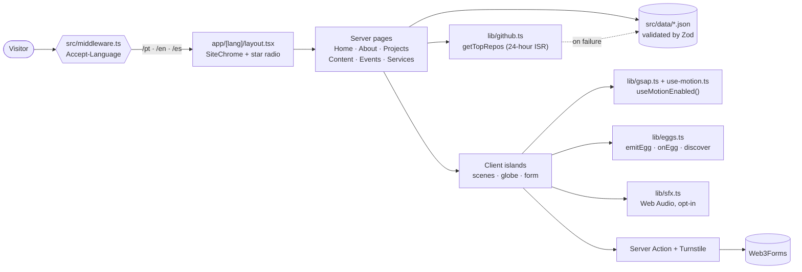

<div align="center">

**English** · [Português](README.pt-BR.md) · [Español](README.es.md)

<br />

# [glaucialemos.dev](https://glaucialemos.dev/)

### *Engineering, AI and curiosity, explored through an original universe in pixel art.*

[](https://github.com/glaucia86/glaucialemos.dev/actions/workflows/ci.yml)


[](https://github.com/glaucia86/glaucialemos.dev/stargazers)


<br />


<sub>Observatório das Primeiras Luzes — approved Home background. Glaucia, Prince and interactive objects are rendered as separate layers.</sub>

</div>

---

> **An expedition through engineering, knowledge and imagination.**
>
> **Galáxia Encantada** is the new creative identity of Glaucia Lemos's portfolio:
> an original space universe in pixel art, with Glaucia and her dog, Prince, as its
> explorers. Each destination connects real work in **engineering, leadership and AI**
> with a world to discover, while keeping professional content accessible.

> [!IMPORTANT]
> **Migration in progress:** the Home has been migrated and approved. About, Projects,
> Content, Events, Services and the 404 page are next and still contain the previous
> theme. The destination names below describe the migration plan, not a completed
> redesign of every route. The optional story mode is also planned.

---

## Table of contents

- [About the project](#about-the-project)
- [Highlights](#highlights)
- [Art pipeline](#art-pipeline)
- [Tech stack](#tech-stack)
- [Architecture](#architecture)
- [Getting started](#getting-started)
- [Available scripts](#available-scripts)
- [Testing](#testing)
- [Project structure](#project-structure)
- [Easter egg hunt](#easter-egg-hunt)
- [Further reading](#further-reading)
- [Credits and creative direction](#credits-and-creative-direction)
- [About me](#about-me)

---

## About the project

**glaucialemos.dev** is the personal website and portfolio of **Glaucia Lemos**, Principal
Software Engineer and AI Transformation Lead. **Galáxia Encantada** turns the portfolio
into an expedition across observatories, imagined worlds and orbital stations.
The migration preserves the existing routes, professional data and three languages.

| Route | Galáxia Encantada destination | Content | Migration status |
| --- | --- | --- | --- |
| `/` | Language entry point | Picks `/pt`, `/en` or `/es` from `Accept-Language` | Preserved |
| `/[lang]` | Observatório das Primeiras Luzes (Earth) | Introduction, career telescope, projects and contact | Migrated and approved |
| `/[lang]/sobre` | Nivéora, o Mundo Nevado das Auroras | Career trajectory and milestones | Next |
| `/[lang]/projetos` | Marte, Vale das Invenções | Live GitHub data, repository archive and contributions | Planned |
| `/[lang]/conteudo` | Lúmina, a Biblioteca Viva | Articles and learning resources | Planned |
| `/[lang]/eventos` | Atlas das Conexões (Earth orbit) | Interactive globe and speaking history | Planned |
| `/[lang]/servicos` | Aurélia, os Jardins Suspensos | Workshops, mentoring, talks and contact | Planned |
| `404` | Maré Rubra, Coordenadas Perdidas | A lost route and a way back | Planned |

Implementation follows the [migration plan](docs/galaxia-encantada/PLANO-MIGRACAO.md)
page by page, with visual approval before continuing.

## Highlights

- **Cinematic, but never in the way.** GSAP timelines (ScrollTrigger, SplitText, ScrambleText)
  and Lenis smooth scroll power the motion. Navigation never waits for an animation.
- **Motion respects you.** `prefers-reduced-motion` *or* a manual toggle turn every scene
  static, and the choice persists across tabs. Without JavaScript, the site still reads well.
- **Sound is opt-in.** Every effect is synthesized live with the Web Audio API. No audio
  files, and it stays silent until you turn it on.
- **Three languages, one URL scheme.** Switching language swaps only the first URL segment,
  so you stay on the same page.
- **Validated data.** Every JSON dataset (events, projects, career, services) is parsed by Zod
  at load time. An invalid record breaks the build instead of sneaking into production.
- **Live GitHub data.** `getTopRepos` ranks repositories by stars and revalidates every
  24 hours, falling back to a local snapshot if the API fails or times out.
- **Layered pixel art.** Approved background plates, character poses and props are processed
  by Node scripts. Glaucia stays anchored in the scene, blinks and changes pose during interactions.
- **A sky to explore.** The new Home includes auroras, catchable shooting stars, lanterns,
  a career telescope and a spacecraft launch, with Prince joining the discoveries.
- **Accessible secrets.** A shared easter egg registry supports keyboard, touch and the star
  radio. Secrets are replaced page by page as each world is migrated.

## Art pipeline

Approved source art lives in [`docs/art/galaxia-encantada/approved-source`](docs/art/galaxia-encantada/approved-source).
Each scene separates its background plate, Glaucia and Prince poses, and interactive props.
The build script crops poses, extracts the blink overlay, records anchors and exports WebP assets
plus scene metadata.

```bash
node scripts/build-galaxia-assets.mjs earth-observatory --debug
node scripts/build-galaxia-assets.mjs --manifest
```

Generated assets go to `public/galaxia/` and `src/data/galaxia/`. The manifest records source
hashes and approval information. Scene composition and hotspot placement are defined in
`src/lib/scenes.ts` and `src/components/home/ObservatoryScene.tsx`.

## Tech stack

| Layer | Choice | Why |
| --- | --- | --- |
| Framework | [Next.js 15](https://nextjs.org/) (App Router) | Server-first pages, i18n routing, ISR for GitHub data |
| UI | [React 19](https://react.dev/) | Client Components only where there is interaction |
| Language | [TypeScript](https://www.typescriptlang.org/) (strict) | Typed data, dictionaries and easter egg ids |
| Styling | [Tailwind CSS 4](https://tailwindcss.com/) + semantic tokens | Shared brand tokens with distinct palettes for each world |
| Motion | [GSAP 3](https://gsap.com/) + [Lenis](https://lenis.darkroom.engineering/) | Pinned scroll, scrub and text effects that work in every browser |
| Globe | [cobe](https://github.com/shuding/cobe) | A lightweight WebGL globe for the Events page |
| Validation | [Zod 4](https://zod.dev/) | Schemas for every dataset |
| Tests | [Vitest](https://vitest.dev/) + [Playwright](https://playwright.dev/) | Unit tests and real-browser suites |
| Fonts | Geist, Geist Mono, Departure Mono | Self-hosted with `next/font/local` |
| Forms | [Web3Forms](https://web3forms.com/) + [Turnstile](https://developers.cloudflare.com/turnstile/) | No personal e-mail in the code |

## Architecture



## Getting started

### Prerequisites

| Tool | Version | Check with |
| --- | --- | --- |
| [Node.js](https://nodejs.org/) | **22 or newer** (CI uses 22) | `node -v` |
| npm | comes with Node | `npm -v` |
| [Git](https://git-scm.com/) | any recent version | `git --version` |

> [!TIP]
> Using a version manager ([nvm](https://github.com/nvm-sh/nvm), [nvm-windows](https://github.com/coreybutler/nvm-windows),
> [fnm](https://github.com/Schniz/fnm) or [Volta](https://volta.sh/)) makes switching to Node 22 a one-liner.

### Windows

**1. Install Node.js LTS and Git** (PowerShell, with [winget](https://learn.microsoft.com/windows/package-manager/winget/)):

```powershell
winget install OpenJS.NodeJS.LTS
winget install Git.Git
```

Restart the terminal so `node` and `git` are on your `PATH`.

**2. Clone and install:**

```powershell
git clone https://github.com/glaucia86/glaucialemos.dev.git
cd glaucialemos.dev
npm ci
Copy-Item .env.example .env.local
```

**3. Start the dev server:**

```powershell
npm run dev
```

Open <http://localhost:3000>. You will be redirected to `/pt`, `/en` or `/es`.

> [!NOTE]
> On Windows, stopping `npm run start` can leave Next's `node` process listening on the port.
> If you get `EADDRINUSE`, find and stop it:
>
> ```powershell
> netstat -ano | findstr :3000
> taskkill /PID <pid> /F
> ```

### macOS

**1. Install Node.js 22 and Git** (with [Homebrew](https://brew.sh/)):

```bash
brew install node@22 git
echo 'export PATH="$(brew --prefix node@22)/bin:$PATH"' >> ~/.zshrc
source ~/.zshrc
```

**2. Clone and install:**

```bash
git clone https://github.com/glaucia86/glaucialemos.dev.git
cd glaucialemos.dev
npm ci
cp .env.example .env.local
```

**3. Start the dev server:**

```bash
npm run dev
```

Open <http://localhost:3000>.

### Linux

**1. Install Node.js 22 with [nvm](https://github.com/nvm-sh/nvm)** (works on any distro):

```bash
curl -o- https://raw.githubusercontent.com/nvm-sh/nvm/v0.40.3/install.sh | bash
source ~/.bashrc
nvm install 22
```

Git: `sudo apt install git` (Debian/Ubuntu), `sudo dnf install git` (Fedora) or `sudo pacman -S git` (Arch).

**2. Clone and install:**

```bash
git clone https://github.com/glaucia86/glaucialemos.dev.git
cd glaucialemos.dev
npm ci
cp .env.example .env.local
```

**3. Start the dev server:**

```bash
npm run dev
```

Open <http://localhost:3000>.

#### Production build (all systems)

```bash
npm run build
npm run start -- --hostname 127.0.0.1 --port 3100
```

### Environment variables

Every variable is **optional**. The site runs without any of them.

| Variable | Where | What it does |
| --- | --- | --- |
| `WEB3FORMS_ACCESS_KEY` | server only | Web3Forms access key used by the contact Server Action. Never sent to the browser. |
| `TURNSTILE_SITE_KEY` | server (rendered into the widget) | Turnstile widget key, public by design; read at request time, no `NEXT_PUBLIC_` needed. The official script loads only when the contact form enters the viewport. |
| `TURNSTILE_SECRET_KEY` | server only | Secret used to verify the token through Cloudflare Siteverify before sending. |
| `GITHUB_TOKEN` | server only | Raises the GitHub API rate limit used to rank repositories by stars. Without it, the site uses the public limit and falls back to `src/data/projetos.json`. |

The contact form requires all three contact variables; without any one of them, fields and submission are disabled and the LinkedIn button remains available. Copy `.env.example` to `.env.local`, configure the keys, and rebuild after changing the public site key or the form configuration. Keep both server keys out of `NEXT_PUBLIC_*` variables. Configure recipient delivery in Web3Forms, without putting a personal email address in the repository.

The Server Action validates the shared Zod schema, discards honeypot submissions, verifies Turnstile, then posts to Web3Forms. [Web3Forms server-side usage requires a paid plan and server IP whitelisting](https://docs.web3forms.com/getting-started/api-reference). Authorize the site hostname in Turnstile. Without JavaScript, the form still has a Server Action, but the security challenge cannot run; the visible LinkedIn link is the fallback. No contact data is added to mailing lists.

Run `node tests/aurelia.browser.mjs` yourself against your chosen server. `CONTACT_EXPECT=disabled` asserts missing configuration; `CONTACT_EXPECT=enabled` asserts full configuration (use separate builds to check both). The script mocks both providers and the action POST itself, so it cannot send real messages. Vitest mocks server-side fetch to cover each missing variable, validation and provider responses.

## Available scripts

| Command | What it does |
| --- | --- |
| `npm run dev` | Starts the dev server with hot reload |
| `npm run build` | Builds for production (check that `ƒ Middleware` is listed) |
| `npm run start` | Serves the production build |
| `npm run lint` | ESLint (`eslint-config-next`) |
| `npm run typecheck` | `tsc --noEmit` |
| `npm test` | Unit tests with Vitest |
| `npm run test:browser` | Playwright suites against a production server |

## Testing

The same checks run in [GitHub Actions](.github/workflows/ci.yml) on every push and pull request:

```bash
npm run lint && npm run typecheck && npm test && npm run build
```

Browser suites cover hero CTAs, scenes, lifecycle, events and page interactions.
Some suites still describe pages awaiting migration.

```bash
npx playwright install chromium   # first time only
npm run build
npm run test:browser              # starts a server on port 3100 for you
```

To reuse a server that is already running, point the suites at it:

```bash
# macOS / Linux
BASE_URL=http://127.0.0.1:3100 npm run test:browser
```

```powershell
# Windows (PowerShell)
$env:BASE_URL = "http://127.0.0.1:3100"
npm run test:browser
```

## Project structure

```text
glaucialemos.dev/
├── .github/workflows/ci.yml   # lint · typecheck · test · build
├── docs/                      # design notes, art briefs, screenshots
│   └── galaxia-encantada/      # migration plan and handoff
├── public/galaxia/            # generated backgrounds, actors and props
├── public/pixel/              # legacy assets pending page-by-page migration
├── scripts/                   # build-galaxia-assets and other asset tooling
├── src/
│   ├── app/
│   │   ├── [lang]/            # home, sobre, projetos, conteudo, eventos, servicos
│   │   └── *.css              # tokens, pixel UI, scene styles and effects
│   ├── components/
│   │   ├── home/              # Observatory, sky engine, career telescope, hyperspace
│   │   ├── about/             # career components; world migration next
│   │   ├── projects/          # repository archive and GitHub telemetry
│   │   └── motion/            # FxLayer, SmoothScroll
│   ├── data/                  # events, projects, career, services (JSON + Zod)
│   │   └── galaxia/           # generated scene metadata
│   ├── i18n/                  # pt · en · es dictionaries
│   ├── lib/                   # github, career, eggs, sfx, gsap, use-motion
│   └── middleware.ts          # language detection
└── tests/                     # *.test.ts (Vitest) · *.browser.mjs (Playwright)
```

## Easter egg hunt

Open the **star radio** in the header to discover hints, replay secrets and track
your progress. You can also type a code word straight onto the page. The new Home has six
local secrets, alongside the global star map; other pages retain their existing secrets
until their migration.

<details>
<summary><b>Spoilers: a few hints for the Observatory</b></summary>

<br />

| Where | Hint |
| --- | --- |
| Anywhere | A classic code from the 8-bit era, typed or swiped: ↑ ↑ ↓ ↓ ← → ← → B A |
| Home | Glaucia has a telescope with real career milestones to explore |
| Home | Follow Prince's nose to find a signal |
| Home | The mountain hangar and its console are connected |
| Home | Hold the sky through the countdown to launch the spacecraft |
| Home | Switch off all four lanterns and look up |
| Home | Catch three shooting stars and make a wish |

</details>

<sub>On mobile, every secret has an equivalent touch gesture. "Wipe memory" in the star radio resets your progress.</sub>

## Further reading

| Document | Topic |
| --- | --- |
| [`PLANO-MIGRACAO.md`](docs/galaxia-encantada/PLANO-MIGRACAO.md) | Galáxia Encantada creative direction, worlds and migration plan (in Portuguese) |
| [`HANDOFF.md`](docs/galaxia-encantada/HANDOFF.md) | Implementation guidance, preferences and migration handoff (in Portuguese) |
| [`AGENTS.md`](AGENTS.md) | Current engineering conventions and verification commands |
| [`DESIGN-SYSTEM.md`](DESIGN-SYSTEM.md) | Palette, typography, components, scenes (in Portuguese) |
| [`DECISOES.md`](DECISOES.md) | Architecture decision log, with the reasoning behind each choice (in Portuguese) |

Older design documents may still describe the previous theme; the migration plan and
current code define the new direction.

## Credits and creative direction

**Galáxia Encantada** is the portfolio's original creative direction, defined and approved
by Glaucia Lemos. The new worlds feature Glaucia, Prince and a spacecraft designed for this
universe. Source art is produced with AI assistance using Grok Image and reviewed before
integration; provenance and approval information are recorded in the asset manifest.

The migration replaces the former franchise-based identity page by page. Remaining legacy
assets and references will be removed as the corresponding pages are migrated and reviewed.
Please ask before reusing the project's art or texts.

---

## About me

<table>
  <tr>
    <td align="center" width="200">
      
      <br />
      <sub>Engineer, educator and explorer of Galáxia Encantada</sub>
    </td>
    <td>
      <h3>Glaucia Lemos</h3>
      <p><b>Principal Software Engineer · AI Transformation Lead @ Itaú Unibanco</b></p>
      <p>
        I lead the adoption of generative and agentic AI across engineering squads: AI-enabled SDLC,
        RAG, context engineering and Spec-Driven Development.
      </p>
      <p>
        Microsoft MVP, OpenAI Codex Ambassador, Devin Ambassador and Packt co-author. I spent more
        than six years as a Developer Advocate at Microsoft, reaching over 100,000 developers through
        talks, workshops and open-source JavaScript, TypeScript and AI projects.
      </p>
      <p>
        <a href="https://www.youtube.com/@GlauciaLemos"></a>
        <a href="https://www.linkedin.com/in/glaucialemos"></a>
        <a href="https://x.com/glaucia_lemos86"></a>
        <a href="https://www.instagram.com/glaucia.lemos.dev"></a>
        <a href="https://github.com/glaucia86"></a>
      </p>
    </td>
  </tr>
</table>

<div align="center">

<br />

**If this expedition inspired you, [leave a star](https://github.com/glaucia86/glaucialemos.dev/stargazers).**

<sub>Galáxia Encantada · Keep exploring.</sub>

</div>
