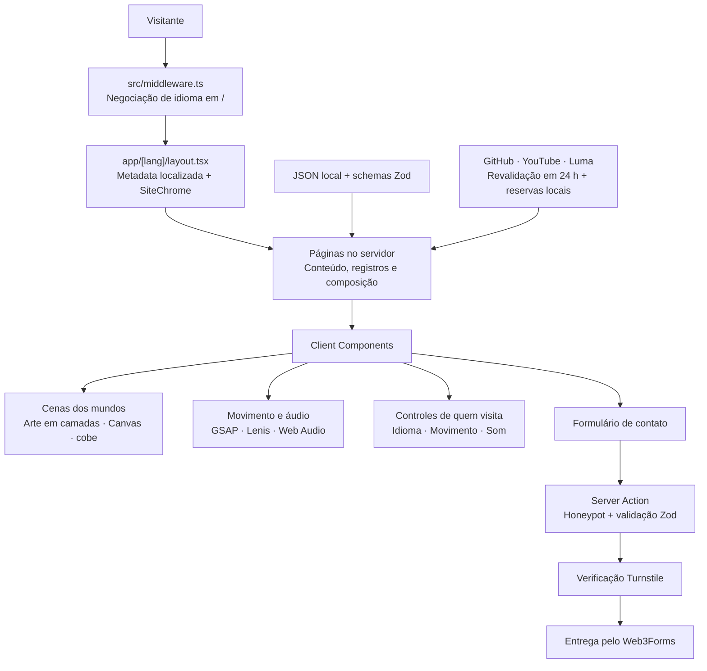

<div align="center">

[English](README.md) · **Português** · [Español](README.es.md)

# Galáxia Encantada

### O portfólio de Glaucia Lemos. Um universo para explorar.

Engenharia, liderança e IA ganham vida em um universo original de pixel art.

[**Entre na galáxia →**](https://glaucialemos.dev/pt) · [Conheça os mundos](#worlds) · [Por dentro da engenharia](#architecture) · [Execute localmente](#getting-started)

[](https://github.com/glaucia86/glaucialemos.dev/actions/workflows/ci.yml)


<a href="https://glaucialemos.dev/pt">
  
</a>

<sub>Observatório das Primeiras Luzes. A paisagem é a base; personagens, clima e interações são camadas independentes.</sub>

</div>

---

Uma carreira vira expedição. Projetos ganham um laboratório em Marte. Artigos habitam uma biblioteca de cristais. Eventos iluminam a Terra vista da órbita.

**glaucialemos.dev** é o portfólio pessoal de Glaucia Lemos, construído como um universo original chamado **Galáxia Encantada**. Glaucia e seu cachorro, **Prince**, acompanham quem visita por seis mundos públicos, cada um com direção de arte, atmosfera e forma de contar uma história próprias.

Por trás dos cenários estão repositórios, registros da carreira, publicações, participações em eventos e serviços reais. Você pode chegar pelo trabalho, ficar pela viagem e escolher quanto movimento e som acompanham a experiência.

> Este README apresenta as paisagens e a engenharia. As descobertas ficam por sua conta, no site.

<a id="worlds"></a>

## Seis mundos. Uma viagem conectada.

<table>
  <tr>
    <td width="50%" valign="top">
      <a href="https://glaucialemos.dev/pt"></a>
      <h3>01 · Observatório das Primeiras Luzes</h3>
      <p><b>Home · Terra</b><br />A apresentação da engenheira, do trabalho e da tripulação, sob um céu que tem vida própria.</p>
    </td>
    <td width="50%" valign="top">
      <a href="https://glaucialemos.dev/pt/sobre"></a>
      <h3>02 · Nivéora</h3>
      <p><b>Sobre · O mundo da neve e das auroras</b><br />Capítulos da carreira, marcos e um diário de expedição formado por anos de engenharia e educação.</p>
    </td>
  </tr>
  <tr>
    <td width="50%" valign="top">
      <a href="https://glaucialemos.dev/pt/projetos"></a>
      <h3>03 · Marte, Vale das Invenções</h3>
      <p><b>Projetos · O vale das invenções</b><br />Um laboratório de repositórios de código aberto, telemetria do GitHub, contribuições e experimentos de engenharia.</p>
    </td>
    <td width="50%" valign="top">
      <a href="https://glaucialemos.dev/pt/conteudo"></a>
      <h3>04 · Lúmina, a Biblioteca Viva</h3>
      <p><b>Conteúdo · A biblioteca viva</b><br />Artigos organizados por ano, idioma e plataforma, com coleções curadas e conexões entre publicações.</p>
    </td>
  </tr>
  <tr>
    <td width="50%" valign="top">
      <a href="https://glaucialemos.dev/pt/eventos"></a>
      <h3>05 · Atlas das Conexões</h3>
      <p><b>Eventos · Órbita da Terra</b><br />Um globo interativo, um diário de eventos e as próximas conexões. Presença física e participação remota contam histórias distintas.</p>
    </td>
    <td width="50%" valign="top">
      <a href="https://glaucialemos.dev/pt/servicos"></a>
      <h3>06 · Aurélia, os Jardins Suspensos</h3>
      <p><b>Serviços · Os jardins suspensos</b><br />Workshops, mentorias, palestras e uma experiência cinematográfica de contato para a próxima colaboração.</p>
    </td>
  </tr>
</table>

Estes são os destinos públicos implementados. Até uma URL perdida tem seu próprio cenário: **Maré Rubra**, a experiência de erro 404.

| Página | Rota |
| --- | --- |
| Entrada por idioma | `/` → `/pt`, `/en` ou `/es`, a partir de `Accept-Language` |
| Home | `/[lang]` |
| Sobre | `/[lang]/sobre` |
| Projetos | `/[lang]/projetos` |
| Conteúdo | `/[lang]/conteudo` |
| Eventos | `/[lang]/eventos` |
| Serviços | `/[lang]/servicos` |
| Coordenadas perdidas | Rotas inexistentes → 404 localizado |

Os slugs das rotas são iguais nos três idiomas. O seletor de idioma preserva o caminho da página.

<a id="experience"></a>

## O que dá vida à galáxia

- **Uma atmosfera própria em cada mundo.** Motores de Canvas desenham estrelas, auroras, neve, poeira, luz de cristais e pétalas. As transições da rolagem seguem a linguagem visual de cada cenário.
- **Um elenco montado em camadas.** Poses aprovadas, sprites transparentes, sobreposições para piscar e objetos ancorados colocam Glaucia e Prince dentro de cada cena.
- **Movimento com direção.** O GSAP coordena timelines, texto, traçados SVG, arraste e coreografias de rolagem. O Lenis compartilha seu ticker; os ciclos das cenas pausam fora da tela ou com a aba oculta.
- **Uma trilha para a viagem.** Cada mundo principal tem sua música, junto de ambiências, efeitos gravados e sons sintetizados com Web Audio. O áudio começa desligado; música e efeitos têm controles de volume separados.
- **Conteúdo profissional para consultar.** Busca de repositórios, estantes de artigos, eras da carreira, diário de eventos e detalhes dos serviços continuam no centro de cada página.
- **O contato participa da cena.** Aurélia abre o formulário num portal, orienta o preenchimento em três etapas e representa visualmente o resultado do envio. A requisição real passa por uma Server Action com validação.
- **Exploração no seu ritmo.** O rádio Comlink do cabeçalho torna a exploração opcional acessível por teclado e toque, com progresso salvo localmente.

<a id="architecture"></a>

## A engenharia por trás dos cenários

**As páginas do App Router do Next.js buscam e preparam o conteúdo no servidor. Client Components acrescentam interação, animação e mídia do navegador ao redor desse conteúdo.** Módulos de domínio transformam registros em linhas do tempo, estantes, telemetria e mapas; os componentes de cada mundo dão identidade visual a esses registros.



| Fronteira | Responsabilidade |
| --- | --- |
| `src/app/[lang]/` | Páginas localizadas, metadata, renderização no servidor e composição |
| `src/lib/data.ts` + `types.ts` | Validar os registros locais com Zod antes de chegarem à interface |
| `src/lib/*-records.ts` | Derivar o conteúdo factual de cada mundo a partir desses registros |
| `src/lib/scenes.ts` + `src/data/galaxia/` | Geometria das cenas, âncoras das poses e metadata dos assets gerados |
| `src/lib/gsap.ts`, `motion.ts`, `use-motion.ts` | Configuração das animações, preferências e ciclo de visibilidade |
| `src/lib/sfx.ts` + `music.ts` | Efeitos, ambiências, música e preferências de volume, sempre opt-in |
| `src/app/actions/contact.ts` | Validar e entregar as solicitações de contato no servidor |

Não há banco de dados da aplicação para provisionar. Dados editoriais e snapshots de reserva ficam no repositório; preferências e progresso da exploração ficam no navegador de quem visita.

### Stack

| Camada | Implementação |
| --- | --- |
| Aplicação | Next.js 15 · React 19 · TypeScript com `strict` habilitado |
| Apresentação | Tailwind CSS 4 · tokens semânticos de CSS · estilos próprios por mundo |
| Movimento | GSAP 3 · `@gsap/react` · ScrollTrigger · SplitText · DrawSVG · Draggable · Lenis |
| Gráficos | Motores Canvas 2D · SVG · CSS 3D · globo WebGL com cobe |
| Áudio e vídeo | Web Audio API · áudio/vídeo HTML · efeitos Ogg/MP3 · vídeo WebM/MP4 |
| Conteúdo e formulários | Zod 4 · React Server Actions · Cloudflare Turnstile · Web3Forms |
| Verificação | ESLint · TypeScript · Vitest · Playwright |
| Fontes | Geist · Geist Mono · Departure Mono, servidas localmente com `next/font/local` |

### Registros reais e integrações com reserva

| Fonte | O que alimenta | Se a rede falhar |
| --- | --- | --- |
| GitHub | Ranking e arquivo de repositórios, perfil e telemetria de contribuições | Snapshots locais de projetos e GitHub |
| RSS público do YouTube | Última publicação longa do canal, com filtro de Shorts | `src/data/youtube.json` |
| Endpoint público de perfil do Luma | Próximos eventos organizados | `src/data/luma.json`, filtrado para datas futuras |
| JSON local curado | Carreira, artigos, histórico de eventos, contribuições e serviços | Disponível diretamente no repositório |

As integrações de rede revalidam os dados a cada 24 horas. O endpoint do Luma não é documentado; a reserva local faz parte da integração. Seu script de snapshot relata eventos ausentes do histórico curado sem adicioná-los automaticamente.

**O mapa representa a presença com precisão:** eventos remotos são sinais, nunca marcadores de cidades visitadas. Países com participação presencial são contados separadamente dos representados remotamente. Eventos usa filtros GET que também funcionam sem JavaScript; a versão aprimorada atualiza os resultados na própria página.

<a id="accessibility"></a>

## Feito para quem está nos controles

- A preferência do sistema `prefers-reduced-motion` e a escolha manual no site controlam as animações.
- O HTML do servidor começa com conteúdo legível; o movimento entra após a hidratação. Layouts com movimento reduzido preservam a informação de forma estática.
- A interface inclui atalho para o conteúdo, foco visível, controles nomeados e alternativas de toque.
- O portal de contato gerencia o foco, aceita Escape e devolve o foco ao fechar.
- Diálogos e painéis sinalizados mantêm a rolagem nativa enquanto o Lenis cuida da página.
- O som começa desligado. Música e ambiências respondem à visibilidade da página; as preferências de áudio persistem localmente.
- O formulário de contato nasce completo antes da hidratação e passa a ter três etapas quando habilitado. **O envio exige JavaScript para o Turnstile**; o LinkedIn continua como alternativa de contato.

Navegador, teclado, tecnologias assistivas e revisão visual continuam fazendo parte da validação.

<a id="getting-started"></a>

## Execute a expedição localmente

Use **Node.js 22**, a versão definida no CI, e npm.

```bash
git clone https://github.com/glaucia86/glaucialemos.dev.git
cd glaucialemos.dev
npm ci
npm run dev
```

Abra [localhost:3000](http://localhost:3000). A raiz seleciona um idioma; você também pode acessar `/pt`, `/en` ou `/es` diretamente.

### Configuração opcional de ambiente

O portfólio funciona sem credenciais. O envio do contato precisa das três chaves de contato.

```bash
# macOS / Linux
cp .env.example .env.local
```

```powershell
# Windows / PowerShell
Copy-Item .env.example .env.local
```

| Variável | Finalidade |
| --- | --- |
| `WEB3FORMS_ACCESS_KEY` | Credencial do servidor para a entrega do contato |
| `TURNSTILE_SECRET_KEY` | Credencial do servidor para verificar o desafio |
| `TURNSTILE_SITE_KEY` | Chave pública do widget, lida pelo servidor e passada ao componente |
| `GITHUB_TOKEN` | Token opcional do servidor para ampliar o limite da API do GitHub; adicione ao `.env.local` se necessário |

Mantenha as credenciais do servidor fora de variáveis `NEXT_PUBLIC_*`. Reinicie o servidor local após mudar o ambiente. Sem as chaves de contato, os campos e o envio ficam desativados e o LinkedIn permanece disponível.

Autorize seu hostname no Turnstile e configure o destinatário no Web3Forms. A integração atual envia pelo servidor; [o Web3Forms exige plano pago e liberação dos IPs do servidor para esse uso](https://docs.web3forms.com/getting-started/api-reference).

<a id="verification"></a>

## Verificação e produção

| Comando | Finalidade |
| --- | --- |
| `npm run dev` | Desenvolvimento local |
| `npm run lint` | ESLint |
| `npm run typecheck` | TypeScript sem emitir JavaScript |
| `npm test` | Suítes unitárias do Vitest |
| `npm run build` | Build de produção |
| `npm run start` | Servir um build de produção existente |
| `npm run test:browser` | Executor de navegador; inicia o servidor de produção se `BASE_URL` não estiver definido |

O [GitHub Actions](.github/workflows/ci.yml) executa instalação, lint, typecheck, testes unitários e build nos pushes para `main` e `feat/**` e nas PRs com destino à `main`. As suítes de navegador rodam separadamente.

```bash
npm run lint
npm run typecheck
npm test
npm run build
```

**Pare o servidor de desenvolvimento antes do build:** ambos usam `.next`. A saída de produção deve listar `ƒ Middleware`.

Para validar no navegador, execute você mesma estes comandos após o build:

```bash
npx playwright install chromium
npm run test:browser -- atlas aurelia
```

O executor aceita nomes de suítes e normalmente usa a porta `3100`. Para reutilizar seu próprio servidor, defina `BASE_URL`:

```bash
# macOS / Linux
BASE_URL=http://127.0.0.1:3100 node tests/atlas.browser.mjs
```

```powershell
# Windows / PowerShell
$env:BASE_URL = "http://127.0.0.1:3100"
node tests/atlas.browser.mjs
```

Os testes de contato no navegador simulam a entrega. A revisão manual de imagem e som complementa as suítes automáticas. No Windows, confira `netstat -ano` se um servidor Next encerrado continuar ocupando a porta.

<a id="art-pipeline"></a>

## Da arte aprovada à cena viva

```text
Fontes aprovadas → recorte e limpeza do fundo → grade e paleta
                → camadas WebP transparentes + JSON da cena
                → composição ancorada + movimento + atmosfera em Canvas
```

O pipeline Node/Sharp preserva as placas de fundo aprovadas enquanto processa as camadas de personagens e objetos. A metadata das cenas mantém dimensões lógicas, dimensões dos pixels exportados e âncoras, para que uma troca de pose continue presa ao ponto correto da composição.

```bash
node scripts/build-galaxia-assets.mjs niveora --debug
node scripts/build-galaxia-assets.mjs --manifest
```

| Local | Função |
| --- | --- |
| `docs/art/galaxia-encantada/approved-source/` | Placas, folhas de personagens e objetos aprovados |
| `docs/art/galaxia-encantada/manifest.json` | Inventário das fontes com hashes SHA-256 |
| `src/data/galaxia/layout.json` | Grade, paletas, escalas e posições por cena |
| `public/galaxia/` | Fundos, sprites, objetos e mídia exportados |
| `src/data/galaxia/` | Metadata gerada e consumida pela aplicação |

Os assets gerados estão versionados, por isso executar o site não exige regenerar a arte.

<a id="project-map"></a>

## Encontre seu caminho no repositório

```text
src/
├── app/
│   ├── [lang]/          Páginas e layouts localizados
│   ├── actions/         Server Action de contato
│   └── *.css            Tokens, estilos dos mundos e interface compartilhada
├── components/          Cenas, seções de página e controles compartilhados
│   └── motion/          Rolagem suave e efeitos de interação compartilhados
├── data/                Registros curados, snapshots e metadata das cenas
├── i18n/                Dicionários e textos dos mundos em PT, EN e ES
├── lib/                 Domínio, integrações e controladores do navegador
└── middleware.ts        Negociação de idioma na raiz
public/
├── galaxia/             Arte e mídia das cenas
├── music/               Trilhas dos mundos
└── sfx/                 Efeitos gravados e ambiências
scripts/                 Pipeline de assets e manutenção dos snapshots
tests/                   Testes unitários e suítes de navegador para execução manual
```

Para manutenção, comece pelo [AGENTS.md](AGENTS.md) e pelo [handoff de implementação](docs/galaxia-encantada/HANDOFF.md). O [design system](DESIGN-SYSTEM.md), o [registro de decisões](DECISOES.md) e o [plano de migração](docs/galaxia-encantada/PLANO-MIGRACAO.md) preservam a história do projeto; entradas antigas podem descrever um design anterior. Os documentos de manutenção incluem detalhes de implementação da narrativa.

<a id="credits"></a>

## Feito pela Glaucia. Explorado com o Prince.

**Glaucia Lemos** conecta engenharia de software, educação técnica, liderança e IA. Este portfólio reúne esse trabalho num universo com identidade visual própria e um copiloto de quatro patas.

[GitHub](https://github.com/glaucia86) · [LinkedIn](https://www.linkedin.com/in/glaucialemos) · [YouTube](https://www.youtube.com/@GlauciaLemos) · [Próximos eventos](https://luma.com/user/glaucia_lemos86)

Direção criativa e aprovação: **Glaucia Lemos**. A arte dos mundos foi produzida com assistência de IA pelo Grok Image e revisada antes da integração.

- Efeitos gravados e ambiências têm [fontes e créditos CC0 próprios](public/sfx/CREDITS.md).
- As músicas dos mundos foram criadas no Manus e fornecidas para este projeto; suas [notas de uso](public/music/CREDITS.md) são separadas dos efeitos CC0.
- Departure Mono é de Helena Zhang, sob [SIL OFL 1.1](src/app/fonts/DepartureMono-LICENSE.txt).
- Peça autorização antes de reutilizar a arte ou os textos do portfólio; as licenças de assets de terceiros não concedem direitos gerais sobre todo o projeto.

<div align="center">

**O código está aqui. A viagem está esperando.**

[Explore a Galáxia Encantada →](https://glaucialemos.dev/pt)

<sub>glaucialemos.dev · Continue explorando.</sub>

</div>
