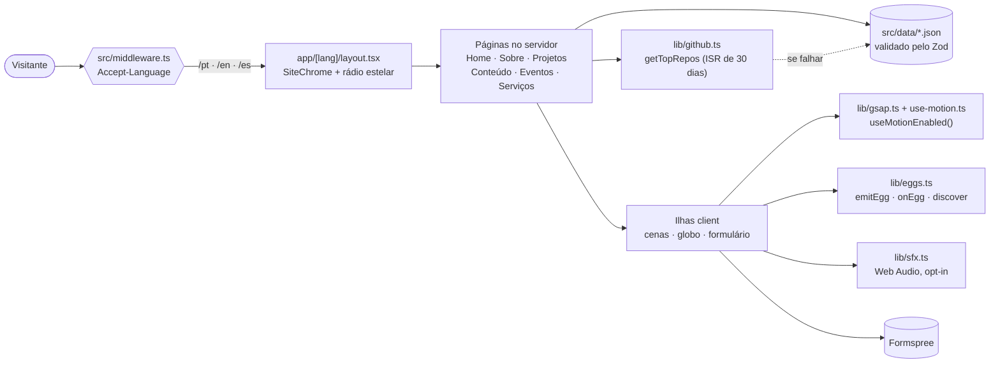

<div align="center">

[English](README.md) · **Português** · [Español](README.es.md)

<br />

# glaucialemos.dev

### *Engenharia, IA e curiosidade em uma expedição por um universo autoral em pixel art.*

[](https://github.com/glaucia86/glaucialemos.dev/actions/workflows/ci.yml)


[](https://github.com/glaucia86/glaucialemos.dev/stargazers)


<br />


<sub>Observatório das Primeiras Luzes — fundo aprovado da Home. Glaucia, Prince e os objetos interativos são renderizados em camadas separadas.</sub>

</div>

---

> **Uma expedição por engenharia, conhecimento e imaginação.**
>
> **Galáxia Encantada** é a nova identidade criativa do portfólio de Glaucia Lemos:
> um universo espacial autoral em pixel art, com Glaucia e seu cachorro, Prince, como
> exploradores. Cada destino conecta o trabalho real em **engenharia, liderança e IA**
> a um mundo para descobrir, mantendo o conteúdo profissional acessível.

> [!IMPORTANT]
> **Migração em andamento:** a Home já foi migrada e aprovada. Sobre, Projetos, Conteúdo,
> Eventos, Serviços e a página 404 ainda usam a identidade anterior e serão migradas a seguir.
> Os destinos abaixo representam o plano de migração, não uma reformulação concluída de
> todas as rotas. O modo história opcional também está planejado.

---

## Sumário

- [Sobre o projeto](#sobre-o-projeto)
- [Destaques](#destaques)
- [Pipeline de arte](#pipeline-de-arte)
- [Stack](#stack)
- [Arquitetura](#arquitetura)
- [Como executar](#como-executar)
  - [Pré-requisitos](#pré-requisitos)
  - [Windows](#windows)
  - [macOS](#macos)
  - [Linux](#linux)
  - [Variáveis de ambiente](#variáveis-de-ambiente)
- [Scripts disponíveis](#scripts-disponíveis)
- [Testes](#testes)
- [Estrutura do projeto](#estrutura-do-projeto)
- [Caça aos easter eggs](#caça-aos-easter-eggs)
- [Para saber mais](#para-saber-mais)
- [Créditos e direção criativa](#créditos-e-direção-criativa)
- [Sobre mim](#sobre-mim)

---

## Sobre o projeto

**glaucialemos.dev** é o site pessoal e portfólio de **Glaucia Lemos**, Principal Software
Engineer e AI Transformation Lead. **Galáxia Encantada** transforma o portfólio em uma
expedição por observatórios, mundos imaginários e estações orbitais. A migração preserva
as rotas existentes, os dados profissionais e os três idiomas.

| Rota | Destino da Galáxia Encantada | Conteúdo | Estado da migração |
| --- | --- | --- | --- |
| `/` | Entrada por idioma | Escolhe `/pt`, `/en` ou `/es` pelo `Accept-Language` | Preservada |
| `/[lang]` | Observatório das Primeiras Luzes (Terra) | Apresentação, telescópio de carreira, projetos e contato | Migrada e aprovada |
| `/[lang]/sobre` | Nivéora, o Mundo Nevado das Auroras | Trajetória profissional e marcos da carreira | Próxima |
| `/[lang]/projetos` | Marte, Vale das Invenções | Dados do GitHub ao vivo, repositórios e contribuições | Planejada |
| `/[lang]/conteudo` | Lúmina, a Biblioteca Viva | Artigos e recursos de aprendizagem | Planejada |
| `/[lang]/eventos` | Atlas das Conexões (órbita da Terra) | Globo interativo e histórico de palestras | Planejada |
| `/[lang]/servicos` | Aurélia, os Jardins Suspensos | Workshops, mentorias, palestras e contato | Planejada |
| `404` | Maré Rubra, Coordenadas Perdidas | Uma rota perdida e um caminho de volta | Planejada |

A implementação segue o [plano de migração](docs/galaxia-encantada/PLANO-MIGRACAO.md)
página a página, com aprovação visual antes de continuar.

## Destaques

- **Cinematográfico, sem atrapalhar.** Timelines GSAP (ScrollTrigger, SplitText, ScrambleText)
  e a rolagem suave do Lenis movem as cenas. A navegação nunca espera uma animação.
- **O movimento respeita você.** `prefers-reduced-motion` *ou* um botão manual deixam todas as
  cenas estáticas, e a escolha vale em todas as abas. Sem JavaScript, o site continua legível.
- **Som só com opt-in.** Os efeitos são sintetizados na hora com a Web Audio API. Não há
  arquivos de áudio, e tudo fica em silêncio até você ligar.
- **Três idiomas, um só esquema de URL.** Trocar o idioma muda apenas o primeiro segmento da
  URL, então você continua na mesma página.
- **Dados validados.** Todo JSON (eventos, projetos, carreira, serviços) passa pelo Zod ao
  carregar. Um registro inválido quebra o build em vez de chegar à produção.
- **GitHub ao vivo.** `getTopRepos` ordena os repositórios por estrelas e revalida a cada
  30 dias. Se a API falhar ou demorar, entra a cópia local.
- **Pixel art em camadas.** Scripts Node processam fundos, poses e objetos aprovados.
  Glaucia fica ancorada na cena, pisca e muda de pose durante as interações.
- **Um céu para explorar.** A nova Home tem auroras, estrelas cadentes que podem ser
  capturadas, lanternas, um telescópio de carreira e a decolagem de uma nave, com Prince nas descobertas.
- **Segredos acessíveis.** Um registro único de easter eggs permite interação por teclado,
  toque e rádio estelar. Os segredos são substituídos à medida que cada mundo é migrado.

## Pipeline de arte

As artes-fonte aprovadas ficam em [`docs/art/galaxia-encantada/approved-source`](docs/art/galaxia-encantada/approved-source).
Cada cena separa a placa de fundo, as poses de Glaucia e Prince e os objetos interativos.
O script recorta as poses, extrai a camada de piscar, registra as âncoras e exporta os assets
em WebP com os metadados da cena.

```bash
node scripts/build-galaxia-assets.mjs earth-observatory --debug
node scripts/build-galaxia-assets.mjs --manifest
```

Os arquivos gerados ficam em `public/galaxia/` e `src/data/galaxia/`. O manifesto registra
os hashes das fontes e as aprovações. A composição e os hotspots são definidos em
`src/lib/scenes.ts` e `src/components/home/ObservatoryScene.tsx`.

## Stack

| Camada | Escolha | Por quê |
| --- | --- | --- |
| Framework | [Next.js 15](https://nextjs.org/) (App Router) | Páginas server-first, rotas por idioma, ISR para os dados do GitHub |
| UI | [React 19](https://react.dev/) | Client Components só onde há interação |
| Linguagem | [TypeScript](https://www.typescriptlang.org/) (strict) | Dados, dicionários e ids de easter eggs tipados |
| Estilo | [Tailwind CSS 4](https://tailwindcss.com/) + tokens semânticos | Tokens de marca compartilhados e paletas próprias para cada mundo |
| Movimento | [GSAP 3](https://gsap.com/) + [Lenis](https://lenis.darkroom.engineering/) | Scroll pinado, scrub e efeitos de texto que funcionam em todos os navegadores |
| Globo | [cobe](https://github.com/shuding/cobe) | Globo WebGL leve para a página de Eventos |
| Validação | [Zod 4](https://zod.dev/) | Schemas para todos os dados |
| Testes | [Vitest](https://vitest.dev/) + [Playwright](https://playwright.dev/) | Testes unitários e suítes em navegador real |
| Fontes | Geist, Geist Mono, Departure Mono | Hospedadas localmente com `next/font/local` |
| Formulários | [Formspree](https://formspree.io/) | Nenhum e-mail pessoal no código |

## Arquitetura



## Como executar

### Pré-requisitos

| Ferramenta | Versão | Como conferir |
| --- | --- | --- |
| [Node.js](https://nodejs.org/) | **22 ou mais recente** (o CI usa 22) | `node -v` |
| npm | vem com o Node | `npm -v` |
| [Git](https://git-scm.com/) | qualquer versão recente | `git --version` |

> [!TIP]
> Um gerenciador de versões ([nvm](https://github.com/nvm-sh/nvm), [nvm-windows](https://github.com/coreybutler/nvm-windows),
> [fnm](https://github.com/Schniz/fnm) ou [Volta](https://volta.sh/)) troca para o Node 22 com um único comando.

### Windows

**1. Instale o Node.js LTS e o Git** (PowerShell, com [winget](https://learn.microsoft.com/windows/package-manager/winget/)):

```powershell
winget install OpenJS.NodeJS.LTS
winget install Git.Git
```

Reabra o terminal para que `node` e `git` entrem no `PATH`.

**2. Clone e instale:**

```powershell
git clone https://github.com/glaucia86/glaucialemos.dev.git
cd glaucialemos.dev
npm ci
Copy-Item .env.example .env.local
```

**3. Suba o servidor de desenvolvimento:**

```powershell
npm run dev
```

Abra <http://localhost:3000>. Você será redirecionado para `/pt`, `/en` ou `/es`.

> [!NOTE]
> No Windows, encerrar o `npm run start` pode deixar o processo `node` do Next escutando na porta.
> Se aparecer `EADDRINUSE`, encontre e encerre o processo:
>
> ```powershell
> netstat -ano | findstr :3000
> taskkill /PID <pid> /F
> ```

### macOS

**1. Instale o Node.js 22 e o Git** (com [Homebrew](https://brew.sh/)):

```bash
brew install node@22 git
echo 'export PATH="$(brew --prefix node@22)/bin:$PATH"' >> ~/.zshrc
source ~/.zshrc
```

**2. Clone e instale:**

```bash
git clone https://github.com/glaucia86/glaucialemos.dev.git
cd glaucialemos.dev
npm ci
cp .env.example .env.local
```

**3. Suba o servidor de desenvolvimento:**

```bash
npm run dev
```

Abra <http://localhost:3000>.

### Linux

**1. Instale o Node.js 22 com [nvm](https://github.com/nvm-sh/nvm)** (funciona em qualquer distro):

```bash
curl -o- https://raw.githubusercontent.com/nvm-sh/nvm/v0.40.3/install.sh | bash
source ~/.bashrc
nvm install 22
```

Git: `sudo apt install git` (Debian/Ubuntu), `sudo dnf install git` (Fedora) ou `sudo pacman -S git` (Arch).

**2. Clone e instale:**

```bash
git clone https://github.com/glaucia86/glaucialemos.dev.git
cd glaucialemos.dev
npm ci
cp .env.example .env.local
```

**3. Suba o servidor de desenvolvimento:**

```bash
npm run dev
```

Abra <http://localhost:3000>.

#### Build de produção (todos os sistemas)

```bash
npm run build
npm run start -- --hostname 127.0.0.1 --port 3100
```

### Variáveis de ambiente

Todas são **opcionais**. O site roda sem nenhuma delas.

| Variável | Onde | O que faz |
| --- | --- | --- |
| `NEXT_PUBLIC_FORMSPREE_ID` | navegador | ID do formulário no Formspree. O envio vai para `https://formspree.io/f/<id>`. Sem ela, o formulário avisa que o envio está indisponível e bloqueia o envio. |
| `GITHUB_TOKEN` | só servidor | Aumenta o limite da API do GitHub usada para ordenar os repositórios por estrelas. Sem ela, vale o limite público, com `src/data/projetos.json` como reserva. |

## Scripts disponíveis

| Comando | O que faz |
| --- | --- |
| `npm run dev` | Servidor de desenvolvimento com hot reload |
| `npm run build` | Build de produção (confira se aparece `ƒ Middleware`) |
| `npm run start` | Serve o build de produção |
| `npm run lint` | ESLint (`eslint-config-next`) |
| `npm run typecheck` | `tsc --noEmit` |
| `npm test` | Testes unitários com Vitest |
| `npm run test:browser` | Suítes Playwright contra um servidor de produção |

## Testes

As mesmas verificações rodam no [GitHub Actions](.github/workflows/ci.yml) a cada push e pull request:

```bash
npm run lint && npm run typecheck && npm test && npm run build
```

As suítes de navegador cobrem os CTAs do hero, as cenas, o ciclo de vida, os eventos e as
interações das páginas. Algumas suítes ainda descrevem páginas que serão migradas.

```bash
npx playwright install chromium   # só na primeira vez
npm run build
npm run test:browser              # sobe um servidor na porta 3100 para você
```

Para reaproveitar um servidor que já está rodando, aponte as suítes para ele:

```bash
# macOS / Linux
BASE_URL=http://127.0.0.1:3100 npm run test:browser
```

```powershell
# Windows (PowerShell)
$env:BASE_URL = "http://127.0.0.1:3100"
npm run test:browser
```

## Estrutura do projeto

```text
glaucialemos.dev/
├── .github/workflows/ci.yml   # lint · typecheck · testes · build
├── docs/                      # notas de design, briefings de arte, screenshots
│   └── galaxia-encantada/      # plano de migração e handoff
├── public/galaxia/            # fundos, personagens e objetos gerados
├── public/pixel/              # assets antigos, substituídos página a página
├── scripts/                   # build-galaxia-assets e ferramentas de arte
├── src/
│   ├── app/
│   │   ├── [lang]/            # home, sobre, projetos, conteudo, eventos, servicos
│   │   └── *.css              # tokens, UI pixel, estilos e efeitos das cenas
│   ├── components/
│   │   ├── home/              # Observatório, céu, telescópio de carreira, hiperespaço
│   │   ├── about/             # componentes de carreira; próximo mundo a migrar
│   │   ├── projects/          # arquivo de repositórios e telemetria do GitHub
│   │   └── motion/            # FxLayer, SmoothScroll
│   ├── data/                  # eventos, projetos, carreira, serviços (JSON + Zod)
│   │   └── galaxia/           # metadados gerados das cenas
│   ├── i18n/                  # dicionários pt · en · es
│   ├── lib/                   # github, career, eggs, sfx, gsap, use-motion
│   └── middleware.ts          # detecção de idioma
└── tests/                     # *.test.ts (Vitest) · *.browser.mjs (Playwright)
```

## Caça aos easter eggs

Abra o **rádio estelar** no cabeçalho para descobrir dicas, repetir os segredos e acompanhar
seu progresso. Você também pode digitar uma palavra-código direto na página. A nova Home
tem seis segredos locais e o mapa estelar global; as outras páginas mantêm seus segredos
atuais até serem migradas.

<details>
<summary><b>Spoilers: algumas dicas para o Observatório</b></summary>

<br />

| Onde | Dica |
| --- | --- |
| Qualquer página | Um código clássico da era 8 bits, digitado ou com gestos: ↑ ↑ ↓ ↓ ← → ← → B A |
| Home | Glaucia tem um telescópio com marcos reais da carreira para explorar |
| Home | Siga o faro de Prince para encontrar um sinal |
| Home | O hangar da montanha e seu console estão conectados |
| Home | Segure o céu durante a contagem para a nave decolar |
| Home | Apague as quatro lanternas e olhe para cima |
| Home | Capture três estrelas cadentes e faça um pedido |

</details>

<sub>No celular, cada segredo tem um gesto de toque equivalente. "Apagar memória" no rádio estelar zera o progresso.</sub>

## Para saber mais

| Documento | Assunto |
| --- | --- |
| [`PLANO-MIGRACAO.md`](docs/galaxia-encantada/PLANO-MIGRACAO.md) | Direção criativa, mundos e plano de migração da Galáxia Encantada |
| [`HANDOFF.md`](docs/galaxia-encantada/HANDOFF.md) | Orientações de implementação, preferências e passagem de contexto |
| [`AGENTS.md`](AGENTS.md) | Convenções de engenharia e comandos de verificação atuais |
| [`DESIGN-SYSTEM.md`](DESIGN-SYSTEM.md) | Paleta, tipografia, componentes, cenas |
| [`DECISOES.md`](DECISOES.md) | Registro de decisões de arquitetura e seus motivos |

Documentos antigos de design ainda podem descrever a identidade anterior; o plano de
migração e o código atual definem a nova direção.

## Créditos e direção criativa

**Galáxia Encantada** é a direção criativa autoral do portfólio, definida e aprovada por
Glaucia Lemos. Os novos mundos têm Glaucia, Prince e uma nave concebida para esse universo.
As artes-fonte são produzidas com auxílio de IA no Grok Image e revisadas antes da integração;
a procedência e as aprovações ficam registradas no manifesto dos assets.

A migração implanta a nova identidade página a página. Os assets e as referências restantes
da versão anterior serão removidos conforme cada página for migrada e revisada.
Peça autorização antes de reutilizar as artes ou os textos do projeto.

---

## Sobre mim

<table>
  <tr>
    <td align="center" width="200">
      
      <br />
      <sub>Engenheira, educadora e exploradora da Galáxia Encantada</sub>
    </td>
    <td>
      <h3>Glaucia Lemos</h3>
      <p><b>Principal Software Engineer · AI Transformation Lead @ Itaú Unibanco</b></p>
      <p>
        Lidero a adoção de IA generativa e agêntica em squads de engenharia: SDLC com IA, RAG,
        context engineering e Spec-Driven Development.
      </p>
      <p>
        Microsoft MVP, OpenAI Codex Ambassador, Devin Ambassador e coautora pela Packt. Na
        Microsoft, foram mais de 6 anos como Developer Advocate, com mais de 100 mil devs
        alcançados em palestras, workshops e projetos open source de JavaScript, TypeScript e IA.
      </p>
      <p>
        <a href="https://www.youtube.com/@GlauciaLemos"></a>
        <a href="https://www.linkedin.com/in/glaucialemos"></a>
        <a href="https://x.com/glaucia_lemos86"></a>
        <a href="https://www.instagram.com/glaucia.lemos.dev"></a>
        <a href="https://github.com/glaucia86"></a>
      </p>
    </td>
  </tr>
</table>

<div align="center">

<br />

**Se esta expedição te inspirou, [deixe uma estrela](https://github.com/glaucia86/glaucialemos.dev/stargazers).**

<sub>Galáxia Encantada · Continue explorando.</sub>

</div>
