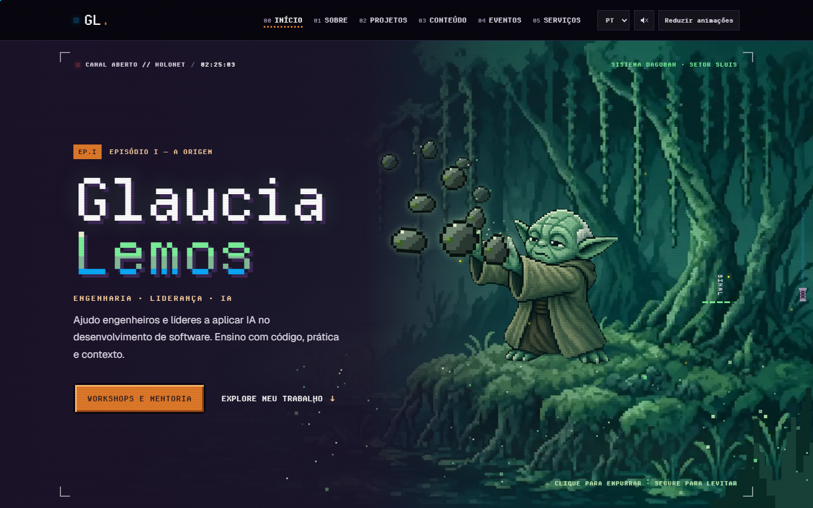
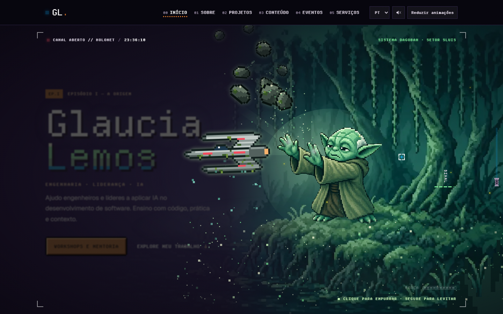
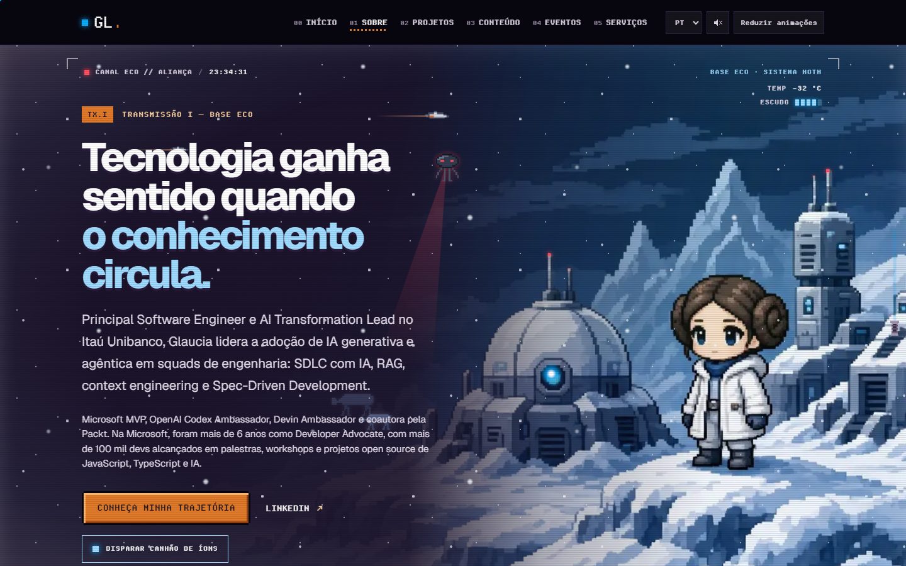
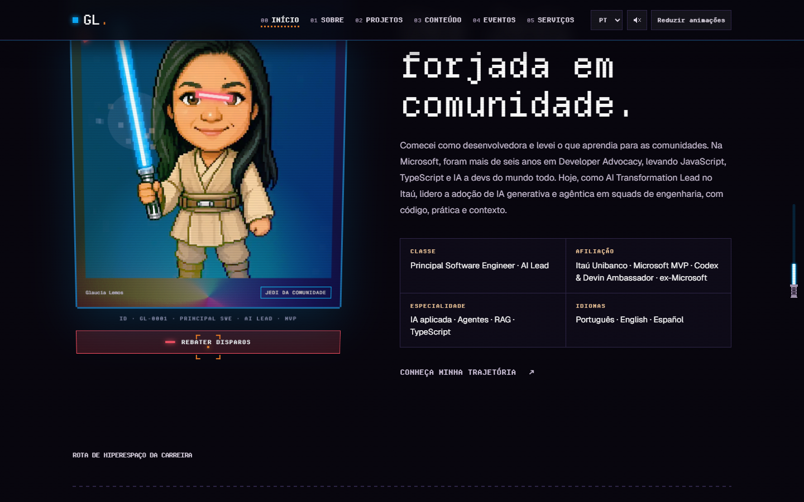
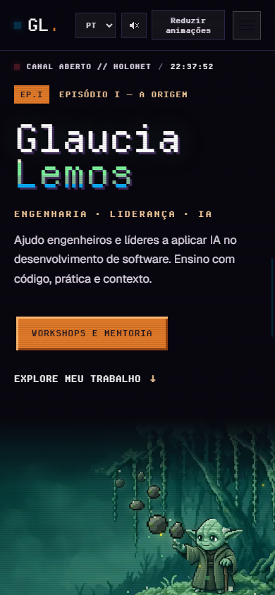
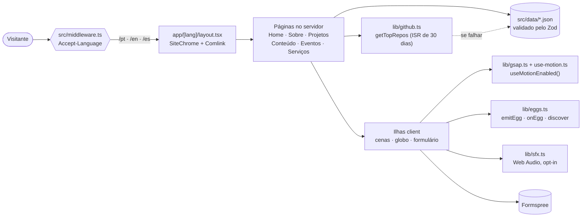
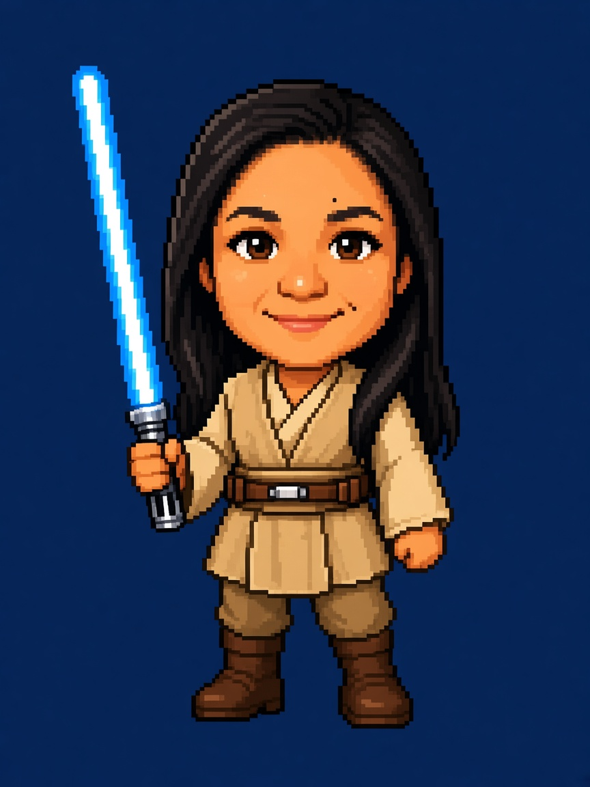

<div align="center">

[English](README.md) · **Português** · [Español](README.es.md)

<br />

<pre>
   ██████╗ ██╗         ·  HOLONET v4.2 // estabelecendo conexão segura
  ██╔════╝ ██║         ·  carregando perfil: GLAUCIA_LEMOS
  ██║  ███╗██║         ·  classe: principal software engineer
  ██║   ██║██║         ·          ai transformation lead · microsoft mvp
  ╚██████╔╝███████╗    ·  ACESSO CONCEDIDO
   ╚═════╝ ╚══════╝
</pre>

# glaucialemos.dev

### *Um site pessoal contado como uma transmissão da HoloNet, em pixel art, direto de uma galáxia muito, muito distante.*

[](https://github.com/glaucia86/glaucialemos.dev/actions/workflows/ci.yml)


[](https://github.com/glaucia86/glaucialemos.dev/stargazers)


<br />



<sub>Episódio I — A Origem. Clique para empurrar as pedras, segure para usar a Força.</sub>

</div>

---

> **Há muito tempo, em um repositório muito, muito distante...**
>
> Uma desenvolvedora que virou educadora global precisava de uma casa na HoloNet. Nada de
> template ou currículo engessado: ela queria um lugar onde **engenharia, liderança e IA**
> fossem contadas como uma história. Armada com Next.js, uma paleta pixelada e um amor
> teimoso por acessibilidade, partiu para construir um site com cara de filme e leitura
> de documentação bem escrita...

---

## Sumário

- [Sobre o projeto](#sobre-o-projeto)
- [Destaques](#destaques)
- [Galeria](#galeria)
- [Stack](#stack)
- [Arquitetura](#arquitetura)
- [Como executar](#como-executar)
  - [Pré-requisitos](#pré-requisitos)
  - [Windows](#windows)
  - [macOS](#macos)
  - [Linux](#linux)
  - [Variáveis de ambiente](#variáveis-de-ambiente)
- [Scripts disponíveis](#scripts-disponíveis)
- [Testes](#testes)
- [Estrutura do projeto](#estrutura-do-projeto)
- [Caça aos easter eggs](#caça-aos-easter-eggs)
- [Para saber mais](#para-saber-mais)
- [Créditos e aviso legal](#créditos-e-aviso-legal)
- [Sobre mim](#sobre-mim)

---

## Sobre o projeto

**glaucialemos.dev** é o site pessoal e portfólio de **Glaucia Lemos**, Principal Software
Engineer e AI Transformation Lead. Cada página é uma cena em um planeta diferente, e a Home
é narrada como uma **transmissão da HoloNet** em cinco episódios:

| Rota | Cena | O que você encontra |
| --- | --- | --- |
| `/` | — | Escolhe `/pt`, `/en` ou `/es` pelo cabeçalho `Accept-Language` |
| `/[lang]` | Dagobah, com Yoda | A história da HoloNet em cinco episódios, números, projetos e contato |
| `/[lang]/sobre` | Base Eco, em Hoth | Trajetória com faixas paralelas, Leia e C-3PO |
| `/[lang]/projetos` | Tatooine, com R2-D2 | Telemetria ao vivo do GitHub, arquivo com filtros e o Esquadrão Microsoft de contribuições |
| `/[lang]/conteudo` | Chewbacca | Artigos e conteúdos com filtros |
| `/[lang]/eventos` | Grogu | Um globo arrastável e o histórico pesquisável de mais de 130 palestras |
| `/[lang]/servicos` | Darth Vader | Workshops, mentorias, palestras e formulário de contato |
| `404` | Stormtrooper | Uma rota perdida, vigiada pelo Império |

## Destaques

- **Cinematográfico, sem atrapalhar.** Timelines GSAP (ScrollTrigger, SplitText, ScrambleText)
  e a rolagem suave do Lenis movem as cenas. A navegação nunca espera uma animação.
- **O movimento respeita você.** `prefers-reduced-motion` *ou* um botão manual deixam todas as
  cenas estáticas, e a escolha vale em todas as abas. Sem JavaScript, o site continua legível.
- **Som só com opt-in.** Os efeitos são sintetizados na hora com a Web Audio API. Não há
  arquivos de áudio, e tudo fica em silêncio até você ligar.
- **Três idiomas, um só esquema de URL.** Trocar o idioma muda apenas o primeiro segmento da
  URL, então você continua na mesma página.
- **Dados validados.** Todo JSON (eventos, projetos, carreira, serviços) passa pelo Zod ao
  carregar. Um registro inválido quebra o build em vez de chegar à produção.
- **GitHub ao vivo.** `getTopRepos` ordena os repositórios por estrelas e revalida a cada
  30 dias. Se a API falhar ou demorar, entra a cópia local.
- **Pixel art em camadas.** Scripts Node separam Leia e Yoda em camadas, para que pisquem,
  tremam de frio, saquem o blaster ou canalizem a Força.
- **24 segredos.** Um registro único de easter eggs, com gatilhos por teclado, gestos de toque
  e terminal (Comlink). Todos podem ser encontrados no celular.

## Galeria

<table>
  <tr>
    <td width="50%"></td>
    <td width="50%"></td>
  </tr>
  <tr>
    <td align="center"><sub><b>Dagobah</b>: segure por tempo suficiente e um X-wing se ergue.</sub></td>
    <td align="center"><sub><b>Base Eco</b>: a página Sobre, no planeta gelado Hoth.</sub></td>
  </tr>
  <tr>
    <td width="50%"></td>
    <td width="50%"></td>
  </tr>
  <tr>
    <td align="center"><sub><b>Jedi da Comunidade</b>: uma ficha de personagem que rebate disparos.</sub></td>
    <td align="center"><sub><b>Celular</b>: todas as cenas e segredos, também pelo toque.</sub></td>
  </tr>
</table>

## Stack

| Camada | Escolha | Por quê |
| --- | --- | --- |
| Framework | [Next.js 15](https://nextjs.org/) (App Router) | Páginas server-first, rotas por idioma, ISR para os dados do GitHub |
| UI | [React 19](https://react.dev/) | Client Components só onde há interação |
| Linguagem | [TypeScript](https://www.typescriptlang.org/) (strict) | Dados, dicionários e ids de easter eggs tipados |
| Estilo | [Tailwind CSS 4](https://tailwindcss.com/) + tokens semânticos | Uma paleta: roxo `#5a3d7e`, magenta `#893866`, laranja `#e07828` |
| Movimento | [GSAP 3](https://gsap.com/) + [Lenis](https://lenis.darkroom.engineering/) | Scroll pinado, scrub e efeitos de texto que funcionam em todos os navegadores |
| Globo | [cobe](https://github.com/shuding/cobe) | Globo WebGL leve para a página de Eventos |
| Validação | [Zod 4](https://zod.dev/) | Schemas para todos os dados |
| Testes | [Vitest](https://vitest.dev/) + [Playwright](https://playwright.dev/) | Testes unitários e suítes em navegador real |
| Fontes | Geist, Geist Mono, Departure Mono | Hospedadas localmente com `next/font/local` |
| Formulários | [Formspree](https://formspree.io/) | Nenhum e-mail pessoal no código |

## Arquitetura



## Como executar

### Pré-requisitos

| Ferramenta | Versão | Como conferir |
| --- | --- | --- |
| [Node.js](https://nodejs.org/) | **22 ou mais recente** (o CI usa 22) | `node -v` |
| npm | vem com o Node | `npm -v` |
| [Git](https://git-scm.com/) | qualquer versão recente | `git --version` |

> [!TIP]
> Um gerenciador de versões ([nvm](https://github.com/nvm-sh/nvm), [nvm-windows](https://github.com/coreybutler/nvm-windows),
> [fnm](https://github.com/Schniz/fnm) ou [Volta](https://volta.sh/)) troca para o Node 22 com um único comando.

### Windows

**1. Instale o Node.js LTS e o Git** (PowerShell, com [winget](https://learn.microsoft.com/windows/package-manager/winget/)):

```powershell
winget install OpenJS.NodeJS.LTS
winget install Git.Git
```

Reabra o terminal para que `node` e `git` entrem no `PATH`.

**2. Clone e instale:**

```powershell
git clone https://github.com/glaucia86/glaucialemos.dev.git
cd glaucialemos.dev
npm ci
Copy-Item .env.example .env.local
```

**3. Suba o servidor de desenvolvimento:**

```powershell
npm run dev
```

Abra <http://localhost:3000>. Você será redirecionado para `/pt`, `/en` ou `/es`.

> [!NOTE]
> No Windows, encerrar o `npm run start` pode deixar o processo `node` do Next escutando na porta.
> Se aparecer `EADDRINUSE`, encontre e encerre o processo:
>
> ```powershell
> netstat -ano | findstr :3000
> taskkill /PID <pid> /F
> ```

### macOS

**1. Instale o Node.js 22 e o Git** (com [Homebrew](https://brew.sh/)):

```bash
brew install node@22 git
echo 'export PATH="$(brew --prefix node@22)/bin:$PATH"' >> ~/.zshrc
source ~/.zshrc
```

**2. Clone e instale:**

```bash
git clone https://github.com/glaucia86/glaucialemos.dev.git
cd glaucialemos.dev
npm ci
cp .env.example .env.local
```

**3. Suba o servidor de desenvolvimento:**

```bash
npm run dev
```

Abra <http://localhost:3000>.

### Linux

**1. Instale o Node.js 22 com [nvm](https://github.com/nvm-sh/nvm)** (funciona em qualquer distro):

```bash
curl -o- https://raw.githubusercontent.com/nvm-sh/nvm/v0.40.3/install.sh | bash
source ~/.bashrc
nvm install 22
```

Git: `sudo apt install git` (Debian/Ubuntu), `sudo dnf install git` (Fedora) ou `sudo pacman -S git` (Arch).

**2. Clone e instale:**

```bash
git clone https://github.com/glaucia86/glaucialemos.dev.git
cd glaucialemos.dev
npm ci
cp .env.example .env.local
```

**3. Suba o servidor de desenvolvimento:**

```bash
npm run dev
```

Abra <http://localhost:3000>.

#### Build de produção (todos os sistemas)

```bash
npm run build
npm run start -- --hostname 127.0.0.1 --port 3100
```

### Variáveis de ambiente

Todas são **opcionais**. O site roda sem nenhuma delas.

| Variável | Onde | O que faz |
| --- | --- | --- |
| `NEXT_PUBLIC_FORMSPREE_ID` | navegador | ID do formulário no Formspree. O envio vai para `https://formspree.io/f/<id>`. Sem ela, o formulário avisa que o envio está indisponível e bloqueia o envio. |
| `GITHUB_TOKEN` | só servidor | Aumenta o limite da API do GitHub usada para ordenar os repositórios por estrelas. Sem ela, vale o limite público, com `src/data/projetos.json` como reserva. |

## Scripts disponíveis

| Comando | O que faz |
| --- | --- |
| `npm run dev` | Servidor de desenvolvimento com hot reload |
| `npm run build` | Build de produção (confira se aparece `ƒ Middleware`) |
| `npm run start` | Serve o build de produção |
| `npm run lint` | ESLint (`eslint-config-next`) |
| `npm run typecheck` | `tsc --noEmit` |
| `npm test` | Testes unitários com Vitest |
| `npm run test:browser` | Suítes Playwright contra um servidor de produção |

## Testes

As mesmas verificações rodam no [GitHub Actions](.github/workflows/ci.yml) a cada push e pull request:

```bash
npm run lint && npm run typecheck && npm test && npm run build
```

As suítes de navegador cobrem os CTAs do hero, as cenas, o ciclo de vida das cenas, a página de Eventos e a Base Eco:

```bash
npx playwright install chromium   # só na primeira vez
npm run build
npm run test:browser              # sobe um servidor na porta 3100 para você
```

Para reaproveitar um servidor que já está rodando, aponte as suítes para ele:

```bash
# macOS / Linux
BASE_URL=http://127.0.0.1:3100 node tests/holonet.browser.mjs
```

```powershell
# Windows (PowerShell)
$env:BASE_URL = "http://127.0.0.1:3100"; node tests/holonet.browser.mjs
```

## Estrutura do projeto

```text
glaucialemos.dev/
├── .github/workflows/ci.yml   # lint · typecheck · testes · build
├── docs/                      # notas de design, briefings de arte, screenshots
├── public/pixel/              # cenas em pixel art e personagens em camadas
├── scripts/                   # build-leia-layers, build-yoda-force, build-home-map
├── src/
│   ├── app/
│   │   ├── [lang]/            # home, sobre, projetos, conteudo, eventos, servicos
│   │   └── *.css              # tokens, UI pixel, cenas, efeitos Jedi
│   ├── components/
│   │   ├── home/              # Dagobah, BootSequence, partículas da Força, hiperespaço
│   │   ├── about/             # Base Eco, Leia, C-3PO, CareerMap, EchoEggs
│   │   ├── projects/          # Tatooine: R2Telemetry, RepoArchive, AllianceSquadrons, TatooineEggs
│   │   └── motion/            # FxLayer, SmoothScroll
│   ├── data/                  # eventos, projetos, carreira, serviços (JSON + Zod)
│   ├── i18n/                  # dicionários pt · en · es
│   ├── lib/                   # github, career, eggs, sfx, gsap, use-motion
│   └── middleware.ts          # detecção de idioma
└── tests/                     # *.test.ts (Vitest) · *.browser.mjs (Playwright)
```

## Caça aos easter eggs

O site esconde **24 segredos**. Abra o **Comlink** (o terminal no canto da tela) para
acompanhar seu progresso. Digite uma palavra-código nele ou direto na página.

<details>
<summary><b>Spoilers: algumas dicas, se a Força não estiver com você</b></summary>

<br />

| Onde | Dica |
| --- | --- |
| Qualquer página | Um código clássico da era 8 bits, digitado ou com gestos: ↑ ↑ ↓ ↓ ← → ← → B A |
| Home | Clique no pântano. Depois tente segurar por bastante tempo... |
| Home | O sabre de luz de uma Jedi não é só enfeite |
| Base Eco | A princesa tem uma mensagem para um velho general |
| Base Eco | *"Eu te amo."* O que o Han responderia? |
| Base Eco | Algo observa do céu. A Leia tem um blaster. |
| Base Eco | Insista um pouco com o droide de protocolo |
| Base Eco | Fique parada alguns segundos e sinta o frio |
| Tatooine | Um comando antigo, de 2018, ainda responde no terminal do R2 |
| Tatooine | Dois sóis, um depois do outro |
| Tatooine | Segure o R2. Os planos estão neste droide. |
| Tatooine | Procure droides no mercado. Circulando. |
| Tatooine | Mercadores baixinhos de capuz rondam o horizonte: *Utinni!* |
| Tatooine | Um certo Skywalker odeia areia. Um certo BB-8 adora dunas. |

</details>

<sub>No celular, cada segredo tem um gesto de toque equivalente. "Apagar memória" no Comlink zera o progresso.</sub>

## Para saber mais

| Documento | Assunto |
| --- | --- |
| [`DESIGN-SYSTEM.md`](DESIGN-SYSTEM.md) | Paleta, tipografia, componentes, cenas |
| [`DECISOES.md`](DECISOES.md) | Registro de decisões de arquitetura e seus motivos |
| [`docs/cinematic-home.md`](docs/cinematic-home.md) | Direção de movimento da Home e acessibilidade |
| [`docs/dagobah-art.md`](docs/dagobah-art.md) | Como a cena de Dagobah foi reconstruída |
| [`docs/leia-art.md`](docs/leia-art.md) | Briefing e montagem da Leia em camadas |

## Créditos e aviso legal

Este é um **tributo de fã, sem fins comerciais**. *Star Wars* e todos os personagens e nomes
relacionados são marcas registradas da Lucasfilm Ltd. Este projeto não tem afiliação nem
endosso da Lucasfilm ou da Disney. A pixel art, o código e os textos são da autora. Peça
autorização antes de reutilizá-los.

---

## Sobre mim

<table>
  <tr>
    <td align="center" width="200">
      
      <br />
      
      <br />
      <sub>Na vida real · numa galáxia muito, muito distante</sub>
    </td>
    <td>
      <h3>Glaucia Lemos</h3>
      <p><b>Principal Software Engineer · AI Transformation Lead @ Itaú Unibanco</b></p>
      <p>
        Lidero a adoção de IA generativa e agêntica em squads de engenharia: SDLC com IA, RAG,
        context engineering e Spec-Driven Development.
      </p>
      <p>
        Microsoft MVP, OpenAI Codex Ambassador, Devin Ambassador e coautora pela Packt. Na
        Microsoft, foram mais de 6 anos como Developer Advocate, com mais de 100 mil devs
        alcançados em palestras, workshops e projetos open source de JavaScript, TypeScript e IA.
      </p>
      <p>
        <a href="https://www.youtube.com/@GlauciaLemos"></a>
        <a href="https://www.linkedin.com/in/glaucialemos"></a>
        <a href="https://x.com/glaucia_lemos86"></a>
        <a href="https://www.instagram.com/glaucia.lemos.dev"></a>
        <a href="https://github.com/glaucia86"></a>
      </p>
    </td>
  </tr>
</table>

<div align="center">

<br />

**Se esta transmissão te inspirou, [deixe uma estrela](https://github.com/glaucia86/glaucialemos.dev/stargazers). Ajuda a Rebelião.**

<sub>Fim da transmissão // Que a Força esteja com você</sub>

</div>
